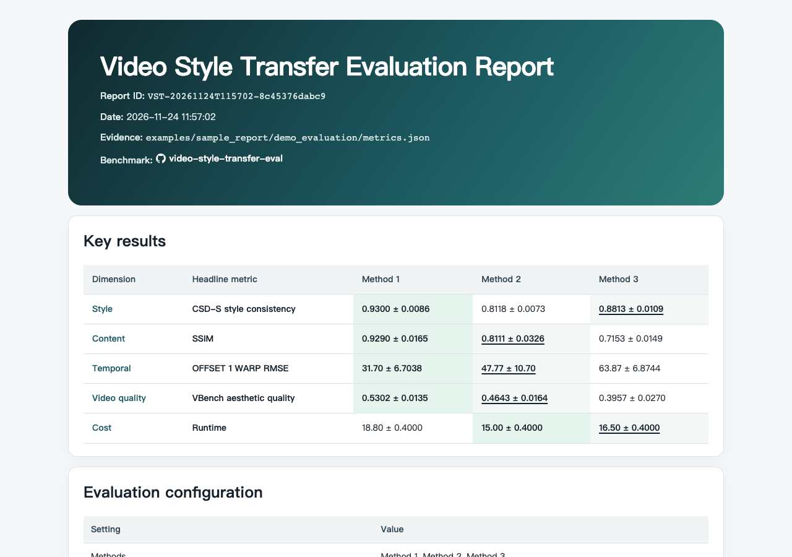
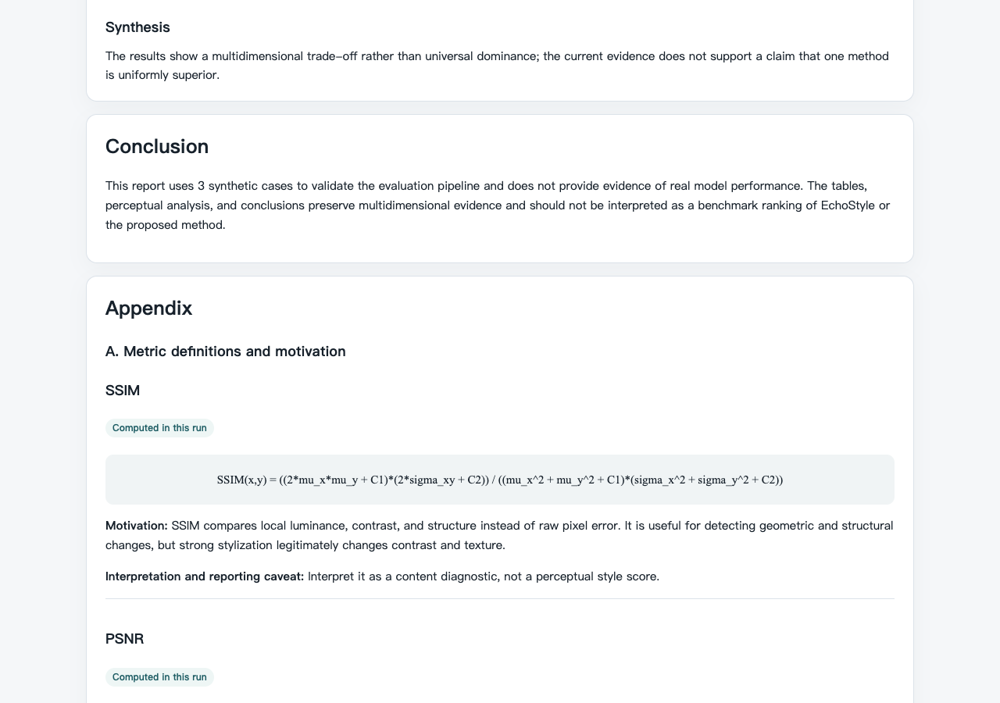
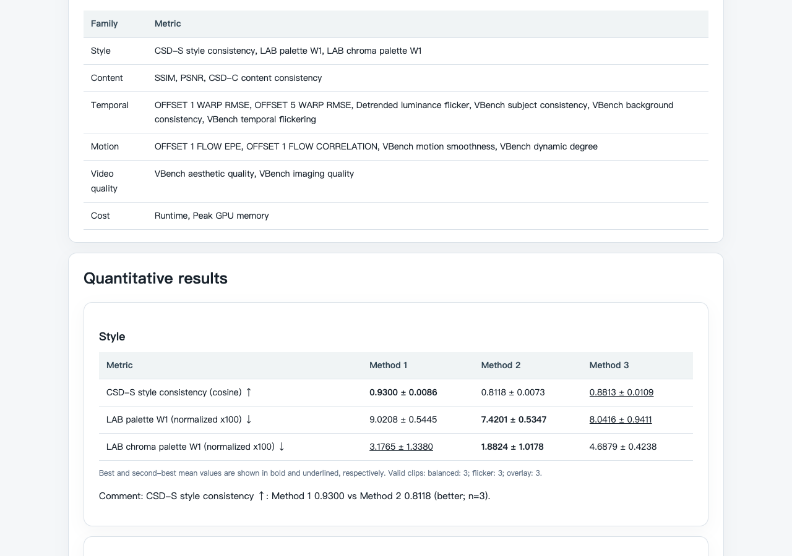

# Video Style Transfer Evaluation

**Languages:** [English](README.md) | [简体中文](README.zh-CN.md)

An agent skill for evaluating video style transfer outputs with paired
style-content-motion diagnostics, blinded visual-language-model review, and
evidence-gated reports.

The tool keeps four questions separate:

1. Does the output adopt the reference style?
2. Does it preserve source content and structure?
3. Does it preserve motion and remain stable over time?
4. What runtime and memory cost does it require?

It produces separate English and Chinese PDF/HTML/Markdown/XeLaTeX reports from
the same machine-readable evidence.

The bundled example under `examples/sample_report` is synthetic. It demonstrates
the evaluation workflow and is not a benchmark of any model.

## Sample report

The screenshots below are rendered from the compiled English sample report.
The full example is available in
[`examples/sample_report`](examples/sample_report/).



*The standalone HTML report opens with the report ID, evidence path and benchmark link, followed by the multi-method key-results matrix, evaluation configuration, metric classification and quantitative tables.*



*The appendix reports each metric with its formula, motivation, availability and interpretation caveat.*



*The report marks best and second-best means and separates per-metric results from paired comparisons.*

## Features

- Paired source/style/output manifests.
- Deterministic diagnostics: SSIM, PSNR, LAB palette distance, Farneback flow
  EPE, source-flow warping error, flow correlation, and luminance flicker.
- Blinded contact sheets with per-case randomized method labels.
- Qualitative assessment (VLM) with per-method scores and failure tags.
- A 1-5 VLM/human rubric for style, content, temporal stability, artifacts, and
  overall quality.
- A strict review validator and evidence tags.
- Merge support for fixed external metrics such as LPIPS, CLIP-I/F, FID,
  ArtFID, tLP, CLIP-CONS, CSD style/content consistency, and VBench video
  quality.
- English and Chinese Markdown, standalone HTML, PDF, and XeLaTeX reports.
- Case study appendix, uncertainty caveats, failure analysis, and report /
  evidence IDs that trace back to the metrics JSON.

## Install

Install the Python dependencies:

```bash
python -m pip install -r requirements.txt
```

Choose the setup guide for your agent:

- [Codex setup](docs/codex.md)
- [Claude Code setup](docs/claude-code.md)

Chinese PDF rendering requires a CJK font with TrueType outlines. The script
auto-detects common Windows, Linux, and macOS fonts. On Linux, install
`fonts-wqy-zenhei` or pass a compatible font:

```bash
python scripts/render_report.py ... \
  --cjk-font /usr/share/fonts/truetype/wqy/wqy-zenhei.ttc
```

## Quick Start

Create a manifest from [assets/manifest.example.json](assets/manifest.example.json),
then run:

```bash
python scripts/evaluate.py \
  --manifest manifest.json \
  --output-dir evaluation_run \
  --blind
```

Review the generated contact sheets using [references/vlm-rubric.md](references/vlm-rubric.md),
then validate the review:

```bash
python scripts/validate_review.py \
  --review reviews/*.json \
  --blind-map evaluation_run/review_packet/blind_map.json
```

Render both languages:

```bash
python scripts/render_report.py \
  --metrics evaluation_run/metrics.json \
  --review evaluation_run/review_packet/validated_reviews.json \
  --output-dir evaluation_report \
  --language both \
  --primary METHOD_ID \
  --baseline BASELINE_ID
```

The output contains:

```text
evaluation_report/
  report_en.pdf
  report_en.html
  report_en.md
  report_en.tex
  report_zh.pdf
  report_zh.html
  report_zh.md
  report_zh.tex
  assets/
```

Use `--language en` or `--language zh` when only one report is needed.
The LaTeX files are standalone XeLaTeX documents with `booktabs` tables,
publication-style captions, best/second-best marking, paired effect sizes,
data-driven discussion, and per-case evidence for direct adaptation into a CVPR
or other computer-vision manuscript.

## Metric Scope

Farneback flow and LAB palette distance are deterministic diagnostic proxies.
They are not substitutes for RAFT, LPIPS, CLIP-I/F, FID, ArtFID, CSD, or
VBench. Use `scripts/merge_metrics.py` with a fixed external implementation and
report the implementation version and preprocessing.

Two adapters write merge-ready evidence:

```bash
# CSD-S / CSD-C frame consistency (GPU host, needs torch + openai-clip)
python scripts/csd_consistency.py --manifest manifest.json \
  --output evidence/csd.json --device cuda

# VBench per-video results (custom_input mode; GPU host)
python scripts/vbench_import.py --manifest manifest.json \
  --results vbench_results --output evidence/vbench.json
```

Both feed `--evidence` on `merge_metrics.py`; the report gains a dedicated
video-quality table and per-metric caveats for every imported dimension.

See:

- [Evaluation protocol](references/evaluation-protocol.md)
- [VLM rubric](references/vlm-rubric.md)
- [Report specification](references/report-spec.md)

## Testing

Run the smoke tests:

```bash
python -m unittest discover -s tests -v
```

## Repository Layout

```text
SKILL.md
docs/codex.md
docs/claude-code.md
docs/echostyle-evaluation-plan.md
docs/echostyle-evaluation-plan.zh-CN.md
agents/
assets/
references/
scripts/
tests/
examples/sample_report/
```

The skill follows progressive disclosure: `SKILL.md` contains the operating
workflow, while detailed protocols and schemas live in `references/`.

To evaluate EchoStyle end to end (including HKUST SuperPOD job templates), see the
runbook in [English](docs/echostyle-evaluation-plan.md) or
[简体中文](docs/echostyle-evaluation-plan.zh-CN.md).

## Project homepage

The bilingual (English / 中文) sample report is published from
[docs/index.html](docs/index.html) and can be served as a GitHub Pages
homepage: Settings → Pages → Deploy from branch → `main` / `/docs`.

## License

MIT. See [LICENSE](LICENSE).
