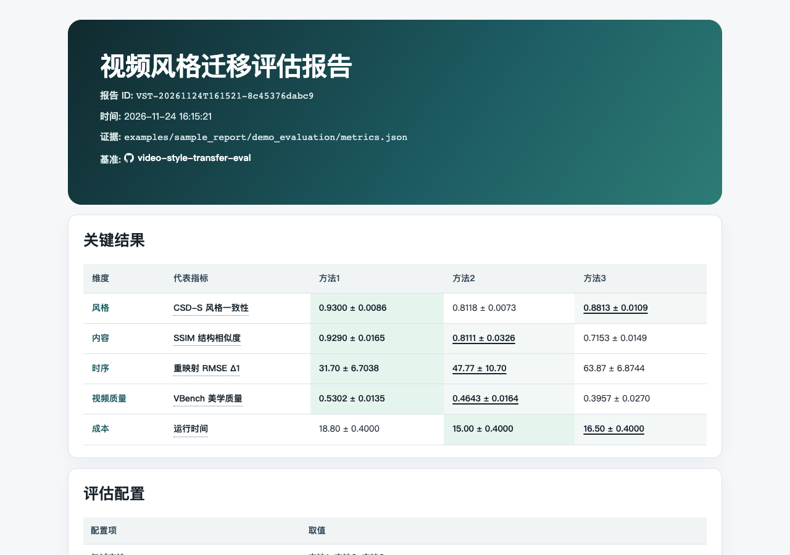
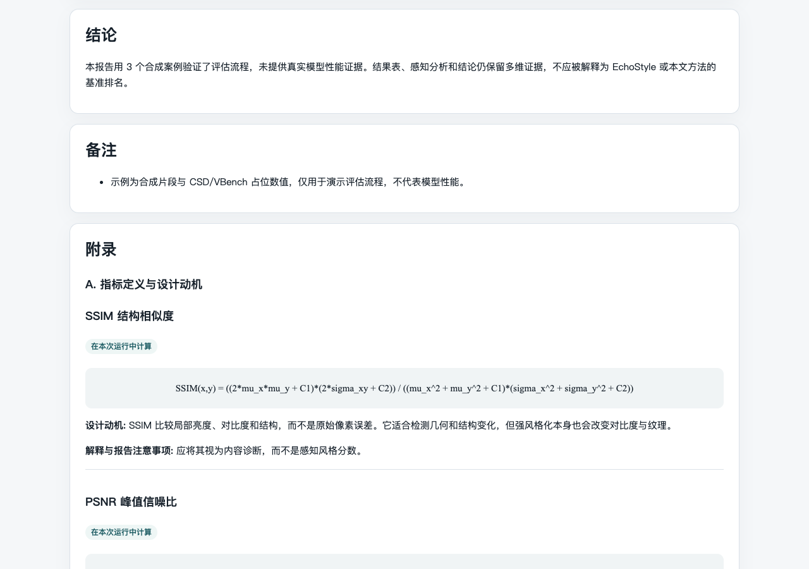
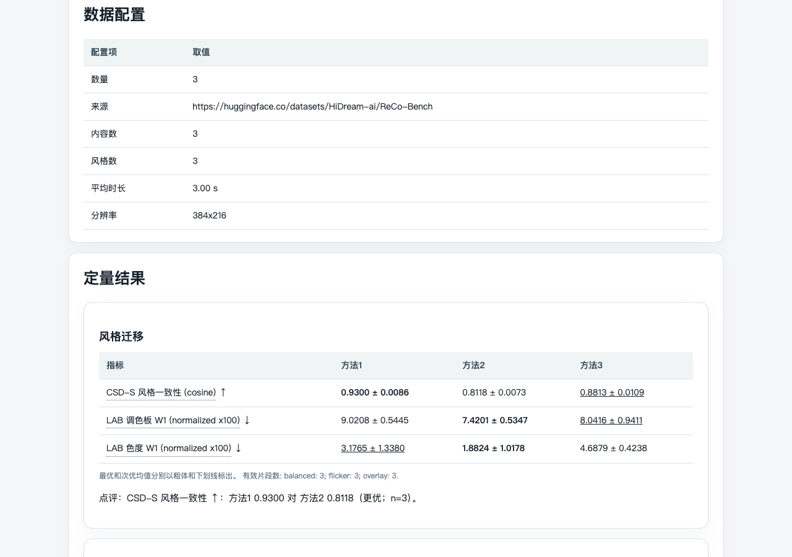

# 视频风格迁移评估

**语言：** [English](README.md) | [简体中文](README.zh-CN.md)

这是一个 Agent 技能，用于评估视频风格迁移输出，支持成对的风格、内容和运动诊断，
盲评视觉语言模型（VLM）审查，以及带证据完整性检查的评估报告。

该工具将以下四个问题分开评估：

1. 输出是否采用了参考图像的风格？
2. 输出是否保持了源视频的内容和结构？
3. 输出是否保持源视频运动，并在时间维度上保持稳定？
4. 运行时间和显存成本是多少？

工具使用同一份机器可读证据，分别生成英文和中文的 PDF、HTML、Markdown 与
XeLaTeX 报告。

`examples/sample_report` 中的示例为合成数据，仅用于演示评估流程，不代表任何模型的性能。

## 示例报告

以下截图来自编译后的中文示例报告。完整示例位于
[`examples/sample_report`](examples/sample_report/)。



*独立 HTML 报告以报告 ID、时间、证据路径与基准链接开头，随后是多方法关键结果矩阵、评估配置、指标分类和定量结果表。*



*附录中每个指标均给出公式、设计动机、可用性和解释注意事项。*



*多方法并排、带单位与偏好方向，最优加粗、次优下划线，并在表下给出结论。*

## 功能

- 成对的源视频、风格图与输出视频清单。
- 确定性诊断指标：SSIM、PSNR、LAB 调色板距离、Farneback 光流 EPE、
  基于源光流的重映射误差、光流相关性和亮度闪烁。
- 每个案例独立随机化方法标签的盲评联系表。
- 定性评估（VLM），按方法给出五维评分与失败标签。
- 面向风格、内容、时序稳定性、伪影和整体质量的 1-5 分 VLM/人工评分标准。
- 严格的审查 JSON 校验和失败标签。
- 合并固定外部实现计算的 LPIPS、CLIP-I/F、FID、ArtFID、tLP、CLIP-CONS、CSD 风格/内容一致性与 VBench 视频质量指标。
- 英文和中文的 Markdown、独立 HTML、PDF 与 XeLaTeX 报告。
- 案例分析附录、不确定度说明、失败分析，以及可回溯到 metrics JSON 的报告 ID / 证据路径。

## 安装

安装 Python 依赖：

```bash
python -m pip install -r requirements.txt
```

请选择对应 Agent 的安装指南：

- [Codex 安装指南](docs/codex.md)
- [Claude Code 安装指南](docs/claude-code.md)

生成中文 PDF 需要具有 TrueType 轮廓的中文字体。脚本会自动检测常见的
Windows、Linux 和 macOS 字体。在 Linux 上可安装 `fonts-wqy-zenhei`，
或通过参数指定兼容字体：

```bash
python scripts/render_report.py ... \
  --cjk-font /usr/share/fonts/truetype/wqy/wqy-zenhei.ttc
```

## 快速开始

参考 [assets/manifest.example.json](assets/manifest.example.json) 创建实验清单，
然后运行诊断指标：

```bash
python scripts/evaluate.py \
  --manifest manifest.json \
  --output-dir evaluation_run \
  --blind
```

按照 [references/vlm-rubric.md](references/vlm-rubric.md) 审查生成的盲评联系表，
然后校验审查结果：

```bash
python scripts/validate_review.py \
  --review reviews/*.json \
  --blind-map evaluation_run/review_packet/blind_map.json
```

同时生成中英文报告：

```bash
python scripts/render_report.py \
  --metrics evaluation_run/metrics.json \
  --review evaluation_run/review_packet/validated_reviews.json \
  --output-dir evaluation_report \
  --language both \
  --primary METHOD_ID \
  --baseline BASELINE_ID
```

输出文件包括：

```text
evaluation_report/
  report_en.pdf
  report_en.html
  report_en.md
  report_en.tex
  report_zh.pdf
  report_zh.html
  report_zh.md
  report_zh.tex
  assets/
```

如果只需要一种语言，可使用 `--language en` 或 `--language zh`。
LaTeX 文件是可直接使用 XeLaTeX 编译的独立文档，包含 `booktabs` 三线表、
论文式表注、最优/次优标记、配对效应量、数据驱动分析和单案例证据，
便于迁移到 CVPR 或其他计算机视觉论文中。

## 指标范围

Farneback 光流与 LAB 调色板距离是确定性诊断代理，不能替代 RAFT、LPIPS、
CLIP-I/F、FID、ArtFID、CSD 或 VBench。若需要论文级指标，请使用固定外部实现计算，
再通过 `scripts/merge_metrics.py` 合并，并记录实现版本和预处理方式。

两个适配器可直接生成可合并的证据文件：

```bash
# CSD-S / CSD-C 帧间一致性（GPU 主机，需要 torch 与 openai-clip）
python scripts/csd_consistency.py --manifest manifest.json \
  --output evidence/csd.json --device cuda

# VBench 逐视频结果（custom_input 模式，GPU 主机）
python scripts/vbench_import.py --manifest manifest.json \
  --results vbench_results --output evidence/vbench.json
```

两者都通过 `merge_metrics.py --evidence` 合并；报告中会新增独立的视频质量表，
并为每个导入维度附上公式、动机与解读注意事项。

进一步阅读：

- [评估协议](references/evaluation-protocol.md)
- [VLM 评分标准](references/vlm-rubric.md)
- [报告规范](references/report-spec.md)

## 测试

```bash
python -m unittest discover -s tests -v
```

## 仓库结构

```text
SKILL.md
docs/codex.md
docs/claude-code.md
docs/echostyle-evaluation-plan.md
docs/echostyle-evaluation-plan.zh-CN.md
agents/
assets/
references/
scripts/
tests/
examples/sample_report/
```

该技能采用渐进式披露方式：`SKILL.md` 保存主要操作流程，
详细协议和数据结构位于 `references/`。

完整评估 EchoStyle 的流程（含 HKUST SuperPOD 作业模板）见
[中文流程](docs/echostyle-evaluation-plan.zh-CN.md) /
[English](docs/echostyle-evaluation-plan.md)。

## VLM 评审 API Key

`scripts/vlm_judge.py` 只从环境变量读取 key，不写入仓库：

- Qwen-VL：`DASHSCOPE_API_KEY`；
- Gemini：`GEMINI_API_KEY`。

推荐放在 `~/.config/video-style-transfer-eval/env`（参考 `.env.example`，
`chmod 600`），或在 shell 中 export；`--env-file PATH` 可指定其他路径。
项目根目录的 `.env` 已被 gitignore。

## 许可证

MIT 许可证，详见 [LICENSE](LICENSE)。
