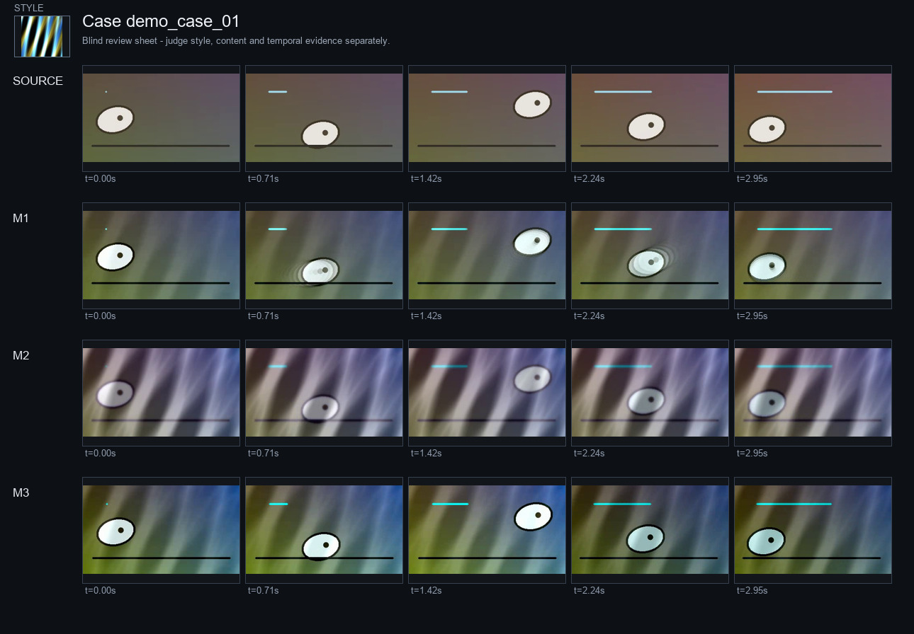
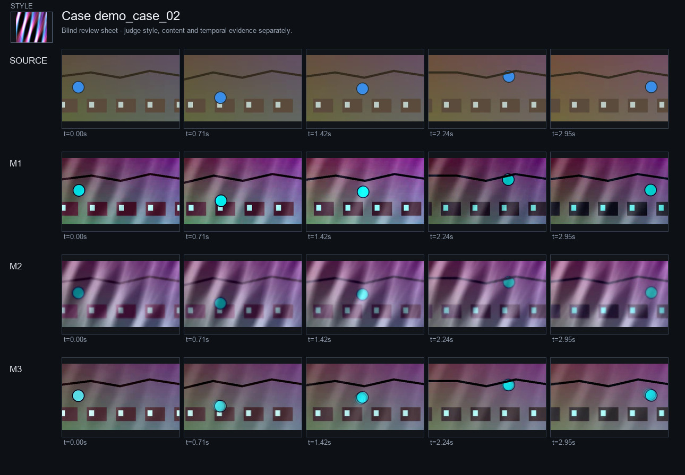
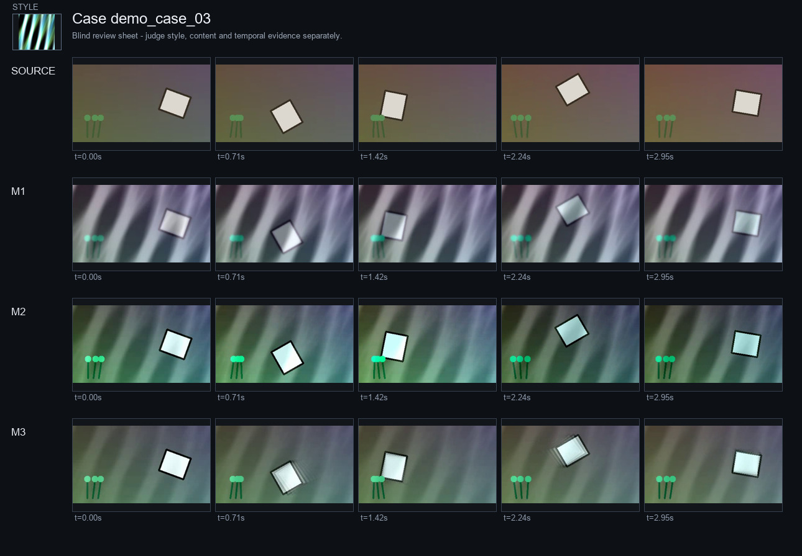

# Video Style Transfer Evaluation - Synthetic Workflow Demonstration

**Claim status:** Exploratory  
**Date:** 2026-11-08  
**Claim:** Demonstrate a reproducible style-content-motion evaluation workflow without presenting synthetic clips as model benchmark evidence.

## Executive verdict

- SSIM ↑: Simulated balanced 0.9290 vs Simulated flicker 0.8111 (better; n=3).
- LAB palette W1 ↓: Simulated balanced 9.0208 vs Simulated flicker 7.4201 (worse; n=3).
- OFFSET 1 WARP RMSE ↓: Simulated balanced 31.70 vs Simulated flicker 47.77 (better; n=3).
- OFFSET 1 FLOW EPE ↓: Simulated balanced 0.2438 vs Simulated flicker 0.5426 (better; n=3).
- Runtime ↓: Simulated balanced 18.80 vs Simulated flicker 15.00 (worse; n=3).
- Blinded VLM review: Simulated balanced has the highest mean overall visual quality (4.00/5 across 1 reviewer(s)); this is perceptual evidence, not benchmark ground truth.
- Most frequent visual failure tag: detail loss (3 occurrence(s)).
- The diagnostic style metric measures palette alignment only; texture and brushwork claims require perceptual evidence.

## Protocol and reproducibility

| Gate | Value | Status |
|---|---|---|
| Paired valid cases | 3 | Pass |
| Methods | 3 | Pass |
| Blinded VLM review | Present | Pass |
| Paper-grade perceptual metrics | Not detected | Not established |
| Claim status | Exploratory | Caveat |

- Flow implementation: OpenCV Farneback (diagnostic proxy)
- Manifest SHA-256: `8c45376dabc97d2fa9e622d26ee8aad963bf4fb802fed099fd52ad8de1c6fa47`
- Sampled frames per video: 30
- Maximum evaluation side: 320 px
- Temporal offsets: [1, 5]
- Blinding: True

## Dataset and pairing

| Case | Content | Style | Split | Valid methods | Warnings |
|---|---|---|---|---|---|
| demo_case_01 | content_01 | style_01 | synthetic_demo | Simulated balanced, Simulated flicker, Simulated overlay | None |
| demo_case_02 | content_02 | style_02 | synthetic_demo | Simulated balanced, Simulated flicker, Simulated overlay | None |
| demo_case_03 | content_03 | style_03 | synthetic_demo | Simulated balanced, Simulated flicker, Simulated overlay | None |

## Quantitative results

### Style

| Metric | Simulated balanced | Simulated flicker | Simulated overlay |
|---|---|---|---|
| LAB palette W1 ↓ | 9.0208 ± 0.5445 | **7.4201 ± 0.5347** | <u>8.0416 ± 0.9411</u> |
| LAB chroma palette W1 ↓ | <u>3.1765 ± 1.3380</u> | **1.8824 ± 1.0178** | 4.6879 ± 0.4238 |

Best and second-best mean values are shown in bold and underlined, respectively. Valid clips: balanced: 3; flicker: 3; overlay: 3.

### Content

| Metric | Simulated balanced | Simulated flicker | Simulated overlay |
|---|---|---|---|
| SSIM ↑ | **0.9290 ± 0.0165** | <u>0.8111 ± 0.0326</u> | 0.7153 ± 0.0149 |
| PSNR ↑ | **22.58 ± 0.9018** | <u>17.54 ± 0.3337</u> | 14.90 ± 0.3931 |

Best and second-best mean values are shown in bold and underlined, respectively. Valid clips: balanced: 3; flicker: 3; overlay: 3.

### Temporal and motion

| Metric | Simulated balanced | Simulated flicker | Simulated overlay |
|---|---|---|---|
| OFFSET 1 WARP RMSE ↓ | **31.70 ± 6.7038** | <u>47.77 ± 10.70</u> | 63.87 ± 6.8744 |
| OFFSET 5 WARP RMSE ↓ | **33.20 ± 5.2688** | <u>46.18 ± 10.55</u> | 63.70 ± 7.5960 |
| OFFSET 1 FLOW EPE ↓ | <u>0.2438 ± 0.0558</u> | 0.5426 ± 0.3239 | **0.1874 ± 0.0547** |
| OFFSET 1 FLOW CORRELATION ↑ | **0.4268 ± 0.2381** | 0.2267 ± 0.0923 | <u>0.2662 ± 0.1339</u> |
| Detrended luminance flicker ↓ | <u>0.1035 ± 0.0619</u> | 12.43 ± 0.4689 | **0.0822 ± 0.0217** |

Best and second-best mean values are shown in bold and underlined, respectively. Valid clips: balanced: 3; flicker: 3; overlay: 3.

### Cost

| Metric | Simulated balanced | Simulated flicker | Simulated overlay |
|---|---|---|---|
| Runtime ↓ | 18.80 ± 0.4000 | **15.00 ± 0.4000** | <u>16.50 ± 0.4000</u> |
| Peak GPU memory ↓ | 12.70 ± 0.0000 | **9.8000 ± 0.0000** | <u>10.40 ± 0.0000</u> |

Best and second-best mean values are shown in bold and underlined, respectively. Valid clips: balanced: 3; flicker: 3; overlay: 3.

### Paired comparison against the primary baseline

| Metric | Δ (positive favors primary) | dz | 95% CI | n |
|---|---|---|---|---|
| SSIM | 0.1180 | 7.1536 | — | 3 |
| LAB palette W1 | -1.6007 | -15.05 | — | 3 |
| OFFSET 1 WARP RMSE | 16.08 | 3.9236 | — | 3 |
| OFFSET 1 FLOW EPE | 0.2988 | 1.0159 | — | 3 |
| Runtime | -3.8000 | n/a | — | 3 |

Mean ± sample standard deviation over valid paired clips; the clip is the statistical unit. Bold and underlined values denote the best and second-best means. Arrows show preferred direction. n is listed in the evidence notes.

## Blinded visual review

| Method | Style | Content | Temporal | Artifacts | Overall |
|---|---|---|---|---|---|
| Simulated balanced | 4.00/5 | 4.67/5 | 3.67/5 | 3.33/5 | 4.00/5 |
| Simulated flicker | 4.67/5 | 3.67/5 | 2.00/5 | 2.00/5 | 2.33/5 |
| Simulated overlay | 3.33/5 | 3.00/5 | 3.00/5 | 2.00/5 | 2.00/5 |

Failure tags: detail loss (3), texture sticking (3), flicker (3), edge ghosting (2), temporal jump (2), texture drift (1), geometry melting (1).

Reviewer records: 1. Scored case/method records: 9. VLM scores are perceptual evidence, not ground truth.

## Analysis and discussion

### Style fidelity

The available indicators collectively favor Simulated flicker. Reported diagnostics: LAB palette W1 9.0208 ± 0.5445; LAB chroma palette W1 3.1765 ± 1.3380. The blinded style-adherence score is 4.00/5.

### Content preservation

The available indicators collectively favor Simulated balanced. Reported diagnostics: SSIM 0.9290 ± 0.0165; PSNR 22.58 ± 0.9018.

### Motion and temporal stability

The available indicators collectively favor Simulated balanced. Reported diagnostics: OFFSET 1 WARP RMSE 31.70 ± 6.7038; OFFSET 5 WARP RMSE 33.20 ± 5.2688; OFFSET 1 FLOW EPE 0.2438 ± 0.0558; Detrended luminance flicker 0.1035 ± 0.0619.

### Perceptual review and failure modes

The blinded review gives the highest overall visual quality to Simulated balanced (4.00/5 across 1 reviewer(s)). This reflects preference on the reviewed sample rather than ground-truth quality. The leading failure modes are detail loss (3), texture sticking (3), flicker (3).

### Computational cost

The available indicators collectively favor Simulated flicker. The primary method uses runtime 18.80 ± 0.4000 s and peak memory 12.70 ± 0.0000 GB.

### Synthesis

The results show a multidimensional trade-off rather than universal dominance; the current evidence does not support a claim that one method is uniformly superior.

## Per-case outcomes

### demo_case_01

| Method | SSIM ↑ | Palette W1 ↓ | Warp RMSE Δ1 ↓ | Flow EPE Δ1 ↓ |
|---|---|---|---|---|
| Simulated balanced | 0.9395 | 8.8136 | 28.61 | 0.2963 |
| Simulated flicker | 0.8270 | 7.3344 | 44.06 | 0.5494 |
| Simulated overlay | 0.7122 | 8.1708 | 65.43 | 0.1389 |

### demo_case_02

| Method | SSIM ↑ | Palette W1 ↓ | Warp RMSE Δ1 ↓ | Flow EPE Δ1 ↓ |
|---|---|---|---|---|
| Simulated balanced | 0.9101 | 8.6103 | 39.39 | 0.2500 |
| Simulated flicker | 0.7736 | 6.9334 | 59.84 | 0.8630 |
| Simulated overlay | 0.7315 | 7.0425 | 69.83 | 0.2467 |

### demo_case_03

| Method | SSIM ↑ | Palette W1 ↓ | Warp RMSE Δ1 ↓ | Flow EPE Δ1 ↓ |
|---|---|---|---|---|
| Simulated balanced | 0.9376 | 9.6385 | 27.09 | 0.1852 |
| Simulated flicker | 0.8327 | 7.9925 | 39.42 | 0.2154 |
| Simulated overlay | 0.7022 | 8.9114 | 56.35 | 0.1766 |

## Ablations and trade-offs

This report compares observed configurations only. A style-preservation frontier is not established unless the manifest contains a controlled style-strength sweep at fixed content, motion, and seed settings.

## Failure gallery

The contact sheets above are the visual evidence packet. Failures should be read together with reviewer evidence and timestamps; attractive stills are not sufficient evidence of temporal quality.

## Threats to validity

- Content and style distributions may not represent the intended use.
- Low-level metrics are sensitive to colorization and compression.
- Farneback flow is not RAFT and can fail on large motion or occlusions.
- A single style image does not define a valid FID style distribution.
- VLM review can have position, content, and prompt bias.
- External baseline numbers copied from papers may not use the same settings.
- Fewer than five clips do not support a stable comparative confidence interval.

## Conclusion and recommendation

This report uses 3 synthetic cases to validate the evaluation pipeline and does not provide evidence of real model performance. The tables, perceptual analysis, and conclusions preserve multidimensional evidence and should not be interpreted as a benchmark ranking of EchoStyle or the proposed method.

### Recommendation

Use these results to validate the evaluation pipeline and choose the next experiment. Do not treat the synthetic run as model evidence.
