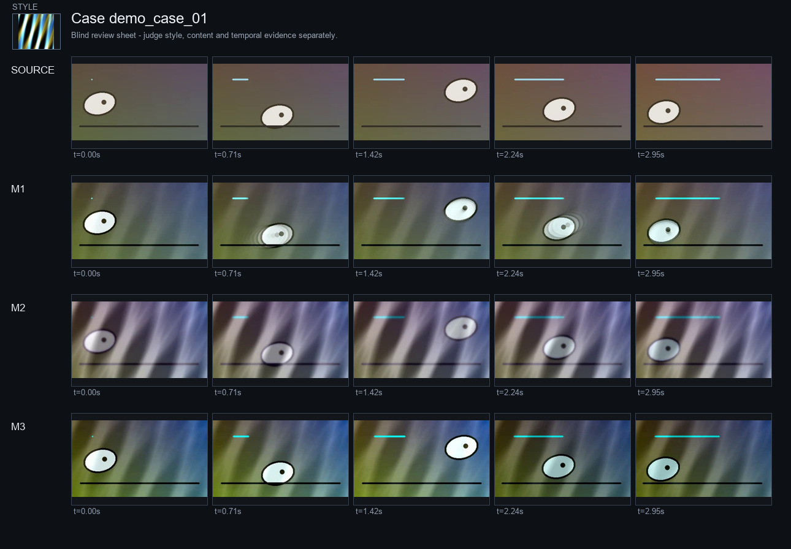
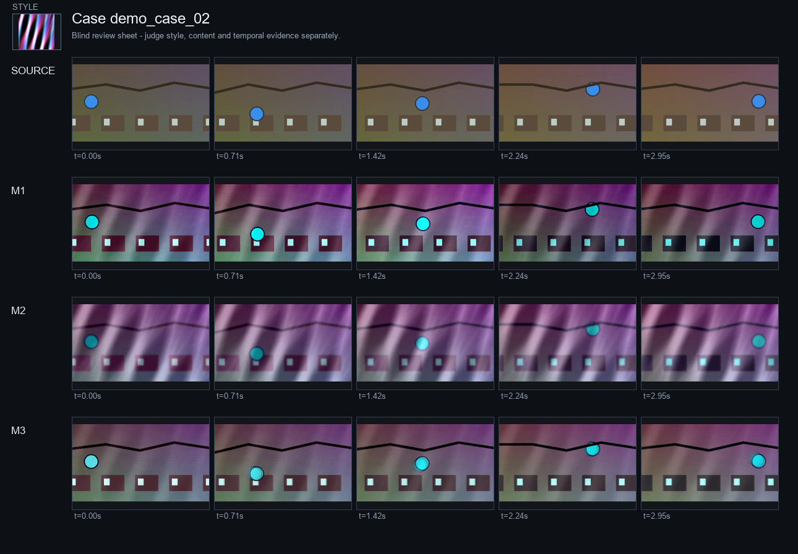
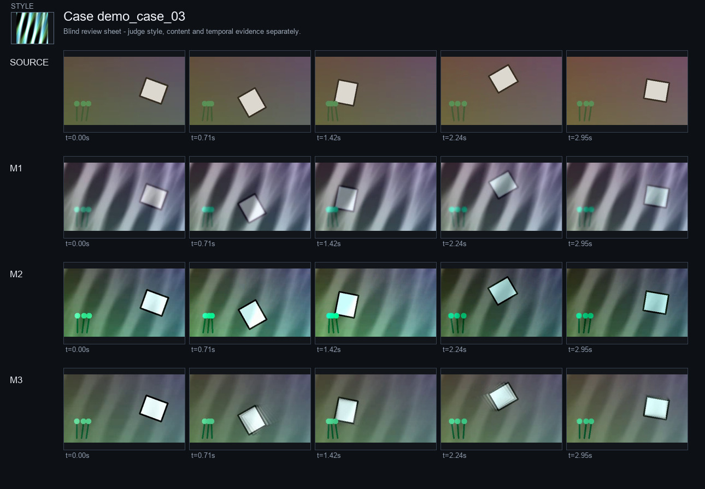

# Video Style Transfer Evaluation Report

**Report ID:** `VST-20261124T144623-8c45376dabc9`  
**Date:** 2026-11-24 14:46:23  
**Evidence:** `examples/sample_report/demo_evaluation/metrics.json`  
**Benchmark:** [video-style-transfer-eval](https://github.com/0x0addc001/video-style-transfer-eval)

## Key results

| Dimension | Headline metric | Method 1 | Method 2 | Method 3 |
|---|---|---|---|---|
| Style | CSD-S style consistency | **0.9300 ± 0.0086** | 0.8118 ± 0.0073 | <u>0.8813 ± 0.0109</u> |
| Content | SSIM | **0.9290 ± 0.0165** | <u>0.8111 ± 0.0326</u> | 0.7153 ± 0.0149 |
| Temporal | OFFSET 1 WARP RMSE | **31.70 ± 6.7038** | <u>47.77 ± 10.70</u> | 63.87 ± 6.8744 |
| Video quality | VBench aesthetic quality | **0.5302 ± 0.0135** | <u>0.4643 ± 0.0164</u> | 0.3957 ± 0.0270 |
| Cost | Runtime | 18.80 ± 0.4000 | **15.00 ± 0.4000** | <u>16.50 ± 0.4000</u> |

## Evaluation configuration

| Setting | Value |
|---|---|
| Methods | Method 1, Method 2, Method 3 |
| Seed | 2026 |
| Sampled frames per video | 30 |
| Maximum evaluation side | 320 px |
| Temporal offsets | [1, 5] |
| Flow implementation | OpenCV Farneback |

### Metric configuration

**Quantitative metrics**

| Family | Metric |
|---|---|
| Style | CSD-S style consistency, LAB palette W1, LAB chroma palette W1 |
| Content | SSIM, PSNR, CSD-C content consistency |
| Temporal | OFFSET 1 WARP RMSE, OFFSET 5 WARP RMSE, Detrended luminance flicker, VBench subject consistency, VBench background consistency, VBench temporal flickering |
| Motion | OFFSET 1 FLOW EPE, OFFSET 1 FLOW CORRELATION, VBench motion smoothness, VBench dynamic degree |
| Video quality | VBench aesthetic quality, VBench imaging quality |
| Cost | Runtime, Peak GPU memory |

**Qualitative metrics**

| Dimension | Value |
|---|---|
| Style adherence | 1-5 |
| Content preservation | 1-5 |
| Temporal stability | 1-5 |
| Artifact control | 1-5 |
| Overall visual quality | 1-5 |

### Data configuration

| Setting | Value |
|---|---|
| Count | 3 |
| Source | https://huggingface.co/datasets/HiDream-ai/ReCo-Bench |
| Contents | 3 |
| Styles | 3 |
| Mean clip duration | 3.00 s |
| Resolution | 384x216 |

## Quantitative results

### Style

| Metric | Method 1 | Method 2 | Method 3 |
|---|---|---|---|
| CSD-S style consistency (cosine) ↑ | **0.9300 ± 0.0086** | 0.8118 ± 0.0073 | <u>0.8813 ± 0.0109</u> |
| LAB palette W1 (normalized x100) ↓ | 9.0208 ± 0.5445 | **7.4201 ± 0.5347** | <u>8.0416 ± 0.9411</u> |
| LAB chroma palette W1 (normalized x100) ↓ | <u>3.1765 ± 1.3380</u> | **1.8824 ± 1.0178** | 4.6879 ± 0.4238 |

Best and second-best mean values are shown in bold and underlined, respectively. Valid clips: balanced: 3; flicker: 3; overlay: 3.

*Conclusion:* CSD-S style consistency ↑: Method 1 0.9300 vs Method 2 0.8118 (better; n=3).

### Content

| Metric | Method 1 | Method 2 | Method 3 |
|---|---|---|---|
| SSIM ↑ | **0.9290 ± 0.0165** | <u>0.8111 ± 0.0326</u> | 0.7153 ± 0.0149 |
| PSNR (dB) ↑ | **22.58 ± 0.9018** | <u>17.54 ± 0.3337</u> | 14.90 ± 0.3931 |
| CSD-C content consistency (cosine) ↑ | **0.9036 ± 0.0177** | <u>0.8440 ± 0.0098</u> | 0.8007 ± 0.0147 |

Best and second-best mean values are shown in bold and underlined, respectively. Valid clips: balanced: 3; flicker: 3; overlay: 3.

*Conclusion:* SSIM ↑: Method 1 0.9290 vs Method 2 0.8111 (better; n=3).

### Temporal and motion

| Metric | Method 1 | Method 2 | Method 3 |
|---|---|---|---|
| OFFSET 1 WARP RMSE (RGB levels) ↓ | **31.70 ± 6.7038** | <u>47.77 ± 10.70</u> | 63.87 ± 6.8744 |
| OFFSET 5 WARP RMSE (RGB levels) ↓ | **33.20 ± 5.2688** | <u>46.18 ± 10.55</u> | 63.70 ± 7.5960 |
| OFFSET 1 FLOW EPE (px) ↓ | <u>0.2438 ± 0.0558</u> | 0.5426 ± 0.3239 | **0.1874 ± 0.0547** |
| OFFSET 1 FLOW CORRELATION ↑ | **0.4268 ± 0.2381** | 0.2267 ± 0.0923 | <u>0.2662 ± 0.1339</u> |
| Detrended luminance flicker (gray levels) ↓ | <u>0.1035 ± 0.0619</u> | 12.43 ± 0.4689 | **0.0822 ± 0.0217** |
| VBench subject consistency (0-1) ↑ | **0.9425 ± 0.0136** | 0.8377 ± 0.0176 | <u>0.8927 ± 0.0116</u> |
| VBench background consistency (0-1) ↑ | **0.9355 ± 0.0019** | 0.8661 ± 0.0181 | <u>0.8791 ± 0.0076</u> |
| VBench temporal flickering (0-1) ↑ | **0.9607 ± 0.0175** | 0.7808 ± 0.0130 | <u>0.9182 ± 0.0121</u> |
| VBench motion smoothness (0-1) ↑ | **0.9854 ± 0.0074** | 0.9101 ± 0.0119 | <u>0.9438 ± 0.0060</u> |
| VBench dynamic degree (0-1) ↑ | <u>0.6688 ± 0.0417</u> | 0.6407 ± 0.0451 | **0.6759 ± 0.0569** |

Best and second-best mean values are shown in bold and underlined, respectively. Valid clips: balanced: 3; flicker: 3; overlay: 3.

*Conclusion:* OFFSET 1 WARP RMSE ↓: Method 1 31.70 vs Method 2 47.77 (better; n=3).

### Video quality

| Metric | Method 1 | Method 2 | Method 3 |
|---|---|---|---|
| VBench aesthetic quality (0-1) ↑ | **0.5302 ± 0.0135** | <u>0.4643 ± 0.0164</u> | 0.3957 ± 0.0270 |
| VBench imaging quality (MUSIQ 0-100) ↑ | **61.11 ± 0.3670** | <u>53.92 ± 2.0326</u> | 48.08 ± 2.1455 |

Best and second-best mean values are shown in bold and underlined, respectively. Valid clips: balanced: 3; flicker: 3; overlay: 3.

*Conclusion:* VBench aesthetic quality ↑: Method 1 0.5302 vs Method 2 0.4643 (better; n=3).

### Cost

| Metric | Method 1 | Method 2 | Method 3 |
|---|---|---|---|
| Runtime (s) ↓ | 18.80 ± 0.4000 | **15.00 ± 0.4000** | <u>16.50 ± 0.4000</u> |
| Peak GPU memory (GB) ↓ | 12.70 ± 0.0000 | **9.8000 ± 0.0000** | <u>10.40 ± 0.0000</u> |

Best and second-best mean values are shown in bold and underlined, respectively. Valid clips: balanced: 3; flicker: 3; overlay: 3.

*Conclusion:* Runtime ↓: Method 1 18.80 vs Method 2 15.00 (worse; n=3).

### Paired comparison against the primary baseline

| Metric | Δ (positive favors primary) | dz | 95% CI | n |
|---|---|---|---|---|
| SSIM | 0.1180 | 7.1536 | — | 3 |
| LAB palette W1 | -1.6007 | -15.05 | — | 3 |
| CSD-S style consistency | 0.1182 | 14.21 | — | 3 |
| CSD-C content consistency | 0.0596 | 2.4649 | — | 3 |
| OFFSET 1 WARP RMSE | 16.08 | 3.9236 | — | 3 |
| OFFSET 1 FLOW EPE | 0.2988 | 1.0159 | — | 3 |
| VBench motion smoothness | 0.0753 | 6.1394 | — | 3 |
| VBench aesthetic quality | 0.0659 | 2.2670 | — | 3 |
| VBench imaging quality | 7.1882 | 3.5071 | — | 3 |
| Runtime | -3.8000 | n/a | — | 3 |

Mean ± sample standard deviation over valid paired clips; the clip is the statistical unit. Bold and underlined values denote the best and second-best means. Arrows show preferred direction. n is listed in the evidence notes.

## Qualitative assessment (VLM)

| Method | Style | Content | Temporal | Artifacts | Overall |
|---|---|---|---|---|---|
| Method 1 | 4.00/5 | 4.67/5 | 3.67/5 | 3.33/5 | 4.00/5 |
| Method 2 | 4.67/5 | 3.67/5 | 2.00/5 | 2.00/5 | 2.33/5 |
| Method 3 | 3.33/5 | 3.00/5 | 3.00/5 | 2.00/5 | 2.00/5 |

Failure tags: detail loss (3), texture sticking (3), flicker (3), edge ghosting (2), temporal jump (2), texture drift (1), geometry melting (1).

Reviewer records: 1. Scored case/method records: 9. VLM scores are perceptual evidence, not ground truth.

## Analysis and discussion

### Style fidelity

The available indicators collectively favor Method 2. Reported diagnostics: CSD-S style consistency 0.9300 ± 0.0086; LAB palette W1 9.0208 ± 0.5445; LAB chroma palette W1 3.1765 ± 1.3380. The blinded style-adherence score is 4.00/5.

### Content preservation

The available indicators collectively favor Method 1. Reported diagnostics: CSD-C content consistency 0.9036 ± 0.0177; SSIM 0.9290 ± 0.0165; PSNR 22.58 ± 0.9018.

### Motion and temporal stability

The available indicators collectively favor Method 1. Reported diagnostics: OFFSET 1 WARP RMSE 31.70 ± 6.7038; OFFSET 5 WARP RMSE 33.20 ± 5.2688; OFFSET 1 FLOW EPE 0.2438 ± 0.0558; Detrended luminance flicker 0.1035 ± 0.0619; VBench subject consistency 0.9425 ± 0.0136; VBench background consistency 0.9355 ± 0.0019; VBench temporal flickering 0.9607 ± 0.0175; VBench motion smoothness 0.9854 ± 0.0074.

### Video quality (VBench)

The available indicators collectively favor Method 1. Reported video-quality metrics: VBench aesthetic quality 0.5302 ± 0.0135; VBench imaging quality 61.11 ± 0.3670.

### Perceptual review and failure modes

The blinded review gives the highest overall visual quality to Method 1 (4.00/5 across 1 reviewer(s)). This reflects preference on the reviewed sample rather than ground-truth quality. The leading failure modes are detail loss (3), texture sticking (3), flicker (3).

### Computational cost

The available indicators collectively favor Method 2. The primary method uses runtime 18.80 ± 0.4000 s and peak memory 12.70 ± 0.0000 GB.

### Synthesis

The results show a multidimensional trade-off rather than universal dominance; the current evidence does not support a claim that one method is uniformly superior.

## Conclusion

This report uses 3 synthetic cases to validate the evaluation pipeline and does not provide evidence of real model performance. The tables, perceptual analysis, and conclusions preserve multidimensional evidence and should not be interpreted as a benchmark ranking of EchoStyle or the proposed method.

## Notes

- Synthetic demo clips and stand-in CSD/VBench values; the numbers illustrate the workflow, not model performance.

## Appendix

### A. Metric definitions and motivation

#### SSIM

**Availability:** Computed in this run

$$SSIM(x,y) = ((2*mu_x*mu_y + C1)*(2*sigma_xy + C2)) / ((mu_x^2 + mu_y^2 + C1)*(sigma_x^2 + sigma_y^2 + C2))$$

**Motivation:** SSIM compares local luminance, contrast, and structure instead of raw pixel error. It is useful for detecting geometric and structural changes, but strong stylization legitimately changes contrast and texture.

**Interpretation and reporting caveat:** Interpret it as a content diagnostic, not a perceptual style score.

#### PSNR

**Availability:** Computed in this run

$$PSNR = 10 * log10(MAX^2 / MSE)$$

**Motivation:** PSNR converts mean squared error into a logarithmic scale and gives a quick, deterministic fidelity diagnostic. It is sensitive to global color shifts, compression, and resolution differences.

**Interpretation and reporting caveat:** Do not treat a small PSNR change as a proportional change in perceived quality.

#### LPIPS

**Availability:** Not provided in this run; definition retained for paper-grade extension

$$LPIPS(x,y) = sum_l (1/(H_l*W_l)) * sum_hw ||w_l * (phi_l(x)_hw - phi_l(y)_hw)||^2$$

**Motivation:** LPIPS compares normalized deep features and aligns better with perceptual similarity than pixel metrics. It is preferred as preservation evidence when a fixed LPIPS implementation is available.

**Interpretation and reporting caveat:** The network, preprocessing, and weights must be identical across every compared method.

#### CLIP-F

**Availability:** Not provided in this run; definition retained for paper-grade extension

$$CLIP-F(R,I) = 100 * cos(phi_I(R), phi_I(I))$$

**Motivation:** CLIP-F measures whether the stylized and original frames retain the same image-level semantics. It complements structure metrics when appearance changes substantially.

**Interpretation and reporting caveat:** Image-level embeddings can miss local identity, boundary, and occlusion errors.

#### CLIP-I

**Availability:** Not provided in this run; definition retained for paper-grade extension

$$CLIP-I(R,S) = 100 * cos(phi_I(R), phi_I(S))$$

**Motivation:** CLIP-I provides a content-robust global signal for whether the generated frame and style reference occupy a similar semantic visual space. It is one component of style evidence, not a texture-transfer proof.

**Interpretation and reporting caveat:** Report it comparatively and supplement it with texture-specific features or blinded review.

#### FID

**Availability:** Not provided in this run; definition retained for paper-grade extension

$$FID = ||mu_s - mu_g||_2^2 + Tr(S_s + S_g - 2*(S_s*S_g)^(1/2))$$

**Motivation:** FID compares Inception feature distributions, so it can capture style-set mismatch beyond single-image color statistics. It requires a meaningful distribution of reference and generated frames.

**Interpretation and reporting caveat:** A single style image is not a valid FID style distribution. Record image count, resolution, and preprocessing.

#### ArtFID

**Availability:** Not provided in this run; definition retained for paper-grade extension

$$ArtFID = (1 + mean_i LPIPS(I_i,R_i)) * (1 + FID(R,S))$$

**Motivation:** ArtFID combines perceptual content preservation and style-distribution distance in one number. The product makes a method visible when it improves one factor while degrading the other.

**Interpretation and reporting caveat:** Do not use it unless its LPIPS and FID components follow the cited, fixed implementation.

#### LAB palette W1

**Availability:** Computed in this run

$$W1_c = sum_k |CDF_frame,c(k) - CDF_style,c(k)| / 255;  PaletteW1 = 100 * mean_c W1_c$$

**Motivation:** This inexpensive diagnostic summarizes marginal LAB color alignment. It is useful for detecting global recoloring and palette mismatch before expensive perceptual metrics.

**Interpretation and reporting caveat:** It does not measure brushwork, texture attachment, composition, or style semantics.

#### Source-flow warping RMSE

**Availability:** Computed in this run

$$WarpRMSE_d = sqrt(sum_x M_t(x)*||R_t(x) - W(R_(t+d))(x)||_2^2 / sum_x M_t(x))$$

**Motivation:** Source optical flow supplies the expected motion. Warping a later output frame back with that flow isolates drift and flicker from legitimate scene motion; occluded pixels are masked.

**Interpretation and reporting caveat:** The result inherits the flow estimator's errors; Farneback is a diagnostic proxy, not RAFT.

#### Flow endpoint error

**Availability:** Computed in this run

$$EPE_d = (1/|Omega|) * sum_{x in Omega} ||F_R(x) - F_I(x)||_2$$

**Motivation:** EPE measures whether stylization changes the estimated displacement between frames. It is sensitive to motion alteration and can reveal propagation failures that still images miss.

**Interpretation and reporting caveat:** Texture changes can create spurious flow; use the same estimator and occlusion handling for every method.

#### Flow-field correlation

**Availability:** Computed in this run

$$rho_d = corr(flatten(F_R), flatten(F_I))$$

**Motivation:** Correlation measures agreement in motion direction independently of the flow magnitude emphasized by EPE. Together they separate directional corruption from displacement scaling.

**Interpretation and reporting caveat:** It is a global summary and may hide localized motion errors.

#### Temporal LPIPS (tLP)

**Availability:** Not provided in this run; definition retained for paper-grade extension

$$tLP = (1/(T-d)) * sum_t LPIPS(R_t, W(R_(t+d)))$$

**Motivation:** tLP replaces pixel error in warping analysis with a perceptual deep-feature error, making texture and structure instability easier to detect than raw L2 differences.

**Interpretation and reporting caveat:** Use a fixed LPIPS network and report the temporal offset.

#### CLIP temporal consistency

**Availability:** Not provided in this run; definition retained for paper-grade extension

$$CLIP-CONS = 100 * cos(phi(R_t+1)-phi(R_t), phi(I_t+1)-phi(I_t))$$

**Motivation:** CLIP-CONS asks whether semantic change between adjacent stylized frames follows the semantic change in the source. It complements pixel warping when content is stylized heavily.

**Interpretation and reporting caveat:** It measures semantic change agreement, not spatial alignment or flicker.

#### Detrended luminance flicker

**Availability:** Computed in this run

$$F = sqrt((1/T) * sum_t (l_t - (a*t+b))^2), where l_t is frame mean luminance$$

**Motivation:** Removing a linear luminance trend distinguishes intentional exposure or scene changes from abrupt global flicker. The measure is cheap and directly targets one common VST artifact.

**Interpretation and reporting caveat:** It ignores local flicker and texture sticking, which require motion-aware or visual review.

#### Blinded VLM score

**Availability:** Computed in this run

$$S_d,m = (1/R) * sum_r (1/|C_valid|) * sum_c s_(r,c,m,d), s in {1,2,3,4,5}$$

**Motivation:** The rubric captures style adherence, content preservation, temporal stability, artifact control, and overall quality when automated metrics cannot separate texture and motion failures. Per-case blinded labels reduce method-identity bias.

**Interpretation and reporting caveat:** VLM judgments are perceptual evidence, not ground truth; record model version and use multiple independent reviewers for paper-level claims.

#### Runtime and peak memory

**Availability:** Computed in this run

$$Runtime_m = mean_c t_(c,m); PeakMemory_m = max_c peak_(c,m)$$

**Motivation:** Quality comparisons are incomplete without deployment cost. Mean runtime captures expected latency, while maximum peak memory captures the worst observed resource requirement.

**Interpretation and reporting caveat:** Measure on identical hardware, precision, resolution, and batch settings; report both mean and peak.

#### CSD-S style consistency

**Availability:** Computed in this run

$$CSD-S = (1/(T-1)) * sum_{t=1}^{T-1} cos(s(f_t), s(f_0))$$

**Motivation:** CSD (contrastive style descriptor) is a CLIP ViT-L/14 image encoder with separate style and content projection heads trained for content-style disentanglement; s(.) is the style head. Comparing every later frame with the first frame measures style drift without folding in content change, which is the 'Style Consis.' column reported by EchoStyle (ECCV 2026).

**Interpretation and reporting caveat:** The score is image-level and does not localize drift. Fix the CSD checkpoint, the CLIP preprocessing, and the frame sampling for every method; absolute cosine values are not comparable across different CSD variants.

#### CSD-C content consistency

**Availability:** Computed in this run

$$CSD-C = (1/(T-1)) * sum_{t=1}^{T-1} cos(c(f_t), c(f_0))$$

**Motivation:** The content head of the same disentangled CSD model gives the companion drift signal. Separating CSD-S from CSD-C distinguishes a method that keeps its style but slowly melts the content from one that loses both.

**Interpretation and reporting caveat:** The content head is a semantic embedding, not a geometric or temporal model. Pair it with source-flow warping error and CLIP-F before concluding that content was preserved.

#### VBench subject consistency

**Availability:** Computed in this run

$$SubjectCons = (1/(T-1)) * sum_t cos(d(f_t), d(f_(t+1))), d = DINO ViT-S/16$$

**Motivation:** VBench uses DINO features to ask whether the same subject survives across frames. In video stylization this catches identity morphing and subject-level flicker that palette and pixel metrics miss.

**Interpretation and reporting caveat:** It rewards static clips, because an unchanged subject always scores high. Read it together with dynamic degree and motion smoothness, and remember that custom-input VBench runs are not leaderboard-comparable.

#### VBench background consistency

**Availability:** Computed in this run

$$BgCons = (1/(T-1)) * sum_t cos(c(f_t), c(f_(t+1))), c = CLIP ViT-B/32$$

**Motivation:** Background consistency tracks whether the scene context drifts or pops between frames. It complements subject consistency: a method can hold the person while repainting the room behind them.

**Interpretation and reporting caveat:** CLIP features are coarse and can still mix subject and background; treat the split between subject and background as indicative, not exact.

#### VBench temporal flickering

**Availability:** Computed in this run

$$Flicker = 1 - (1/(T-1)) * sum_t mean|I_(t+1) - I_t|, I in [0,1]$$

**Motivation:** VBench's pixel-level static consistency term penalizes sudden global changes between adjacent frames. It is a useful sanity check on the diagnostic luminance-flicker measure because it reacts to any channel, not only luma.

**Interpretation and reporting caveat:** Pixel differences also punish legitimate fast motion and hard cuts. Do not rank a dynamic clip against a static clip on this metric alone.

#### VBench motion smoothness

**Availability:** Computed in this run

$$MotionSmooth = 1 - (1/(T-2)) * sum_t ||I_t - AMT(I_(t-1), I_(t+1))||^2$$

**Motivation:** VBench interpolates held-out frames with AMT and treats interpolation error as a smoothness signal. Unlike source-to-output flow metrics it does not need a paired source, so it also works when only generated videos are available.

**Interpretation and reporting caveat:** The score depends on the AMT checkpoint and partly rewards motion blur or oversmoothing; a blurry result can look 'smooth'.

#### VBench dynamic degree

**Availability:** Computed in this run

$$DynDegree = (1/|V|) * sum_v 1[mean flow magnitude(v) > tau]$$

**Motivation:** Dynamic degree reports the fraction of clips with enough estimated motion to be considered dynamic. It is VBench's guard against models that pass consistency metrics by generating nearly static videos.

**Interpretation and reporting caveat:** Higher is not automatically better: exaggerated motion raises the score while damaging content fidelity. Compare only clips with comparable source motion.

#### VBench aesthetic quality

**Availability:** Computed in this run

$$Aesthetic = (1/T) * sum_t LAION-Aesthetic(I_t)$$

**Motivation:** The LAION aesthetic predictor supplies a learned preference score per frame. It is one of the few public signals for the 'does it look good' question that pixel fidelity metrics cannot answer.

**Interpretation and reporting caveat:** It is trained on photographic aesthetics and can penalize deliberately painterly, ink-wash, or stylized textures. Never use it as a style-transfer score on its own.

#### VBench imaging quality

**Availability:** Computed in this run

$$Imaging = (1/T) * sum_t MUSIQ(I_t)$$

**Motivation:** MUSIQ is a no-reference image-quality model, so it can flag compression, blur, and noise artifacts without a ground-truth target. EchoStyle reports this column as 'Imaging Qual.'

**Interpretation and reporting caveat:** No-reference quality models can reward oversharpening and may score a heavily textured painting style lower than a clean photo. Report the model version and input resolution.

### B. Dataset and pairing

| Case | Content | Style | Split | Valid methods | Warnings |
|---|---|---|---|---|---|
| demo_case_01 | content_01 | style_01 | synthetic_demo | Method 1, Method 2, Method 3 | None |
| demo_case_02 | content_02 | style_02 | synthetic_demo | Method 1, Method 2, Method 3 | None |
| demo_case_03 | content_03 | style_03 | synthetic_demo | Method 1, Method 2, Method 3 | None |

### C. Per-case outcomes

#### demo_case_01

| Method | SSIM ↑ | Palette W1 ↓ | Warp RMSE Δ1 ↓ | Flow EPE Δ1 ↓ |
|---|---|---|---|---|
| Method 1 | 0.9395 | 8.8136 | 28.61 | 0.2963 |
| Method 2 | 0.8270 | 7.3344 | 44.06 | 0.5494 |
| Method 3 | 0.7122 | 8.1708 | 65.43 | 0.1389 |

#### demo_case_02

| Method | SSIM ↑ | Palette W1 ↓ | Warp RMSE Δ1 ↓ | Flow EPE Δ1 ↓ |
|---|---|---|---|---|
| Method 1 | 0.9101 | 8.6103 | 39.39 | 0.2500 |
| Method 2 | 0.7736 | 6.9334 | 59.84 | 0.8630 |
| Method 3 | 0.7315 | 7.0425 | 69.83 | 0.2467 |

#### demo_case_03

| Method | SSIM ↑ | Palette W1 ↓ | Warp RMSE Δ1 ↓ | Flow EPE Δ1 ↓ |
|---|---|---|---|---|
| Method 1 | 0.9376 | 9.6385 | 27.09 | 0.1852 |
| Method 2 | 0.8327 | 7.9925 | 39.42 | 0.2154 |
| Method 3 | 0.7022 | 8.9114 | 56.35 | 0.1766 |

### D. Ablations and trade-offs

This report compares observed configurations only. A style-preservation frontier is not established unless the manifest contains a controlled style-strength sweep at fixed content, motion, and seed settings.

### E. Failure gallery

The contact sheets above are the visual evidence packet. Failures should be read together with reviewer evidence and timestamps; attractive stills are not sufficient evidence of temporal quality.

### F. Threats to validity

- Content and style distributions may not represent the intended use.
- Low-level metrics are sensitive to colorization and compression.
- Farneback flow is not RAFT and can fail on large motion or occlusions.
- A single style image does not define a valid FID style distribution.
- VLM review can have position, content, and prompt bias.
- External baseline numbers copied from papers may not use the same settings.
- Fewer than five clips do not support a stable comparative confidence interval.

