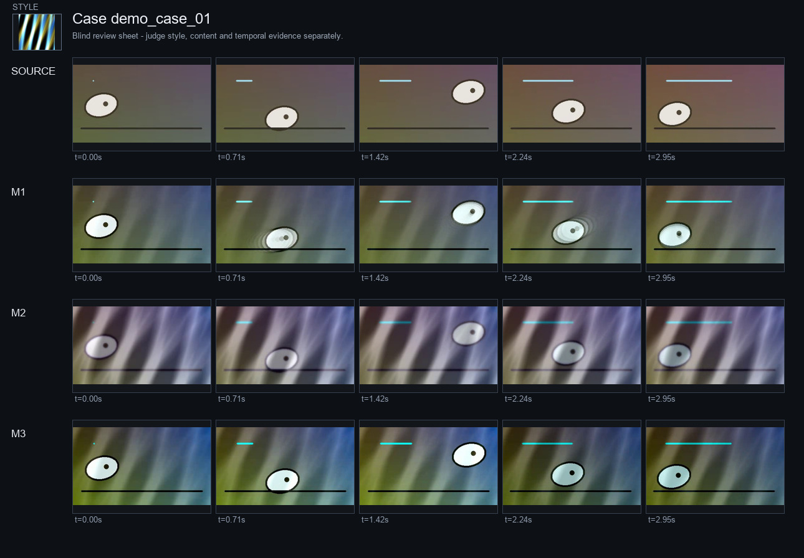
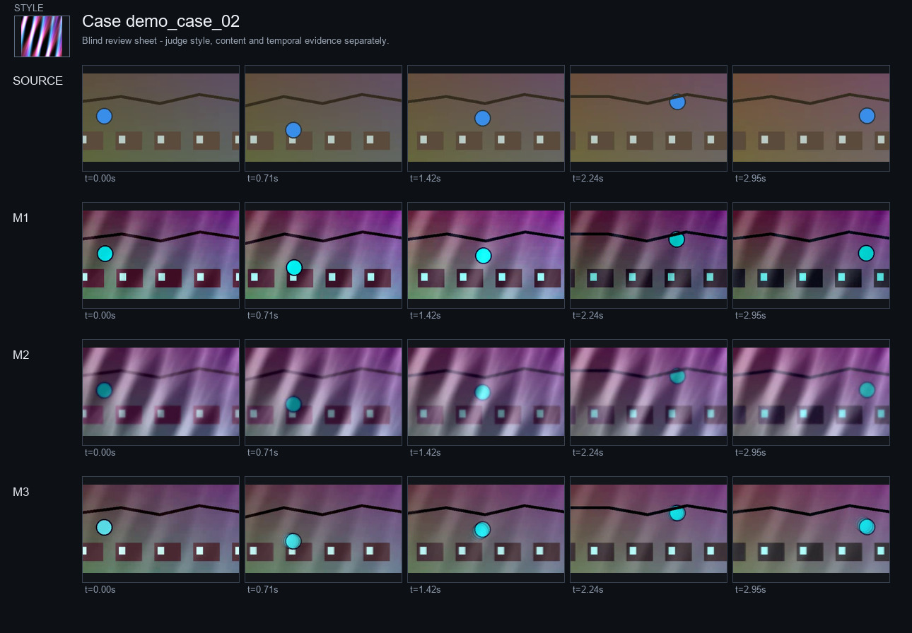
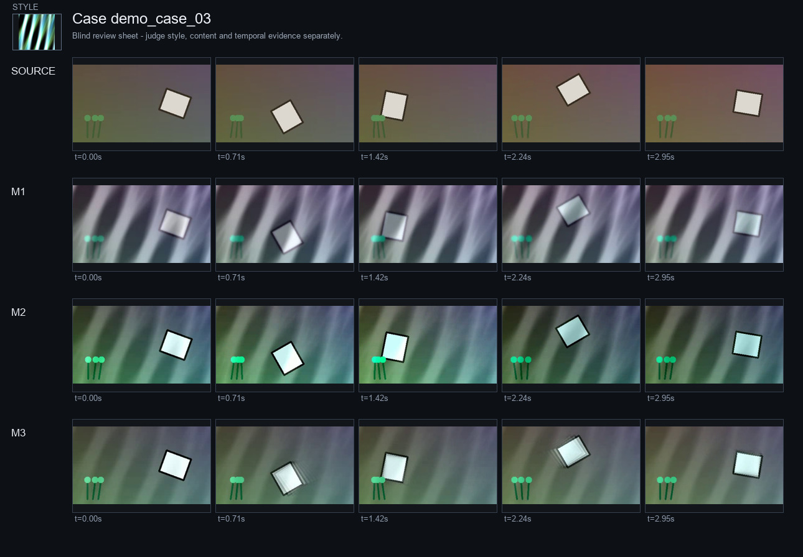

# 视频风格迁移评估 - 合成流程演示

**结论状态:** 探索性  
**日期:** 2026-11-08  
**评估目标:** 演示可复现的风格、内容与运动评估流程，并明确合成片段不能作为模型基准证据。

## 执行摘要

- SSIM 结构相似度 ↑：模拟平衡方法 0.9290 对 模拟闪烁方法 0.8111（更优；n=3）。
- LAB 调色板 W1 ↓：模拟平衡方法 9.0208 对 模拟闪烁方法 7.4201（较差；n=3）。
- 重映射 RMSE Δ1 ↓：模拟平衡方法 31.70 对 模拟闪烁方法 47.77（更优；n=3）。
- 光流端点误差 Δ1 ↓：模拟平衡方法 0.2438 对 模拟闪烁方法 0.5426（更优；n=3）。
- 运行时间 ↓：模拟平衡方法 18.80 对 模拟闪烁方法 15.00（较差；n=3）。
- 盲评 VLM 审查：模拟平衡方法的整体视觉质量均值最高（4.00/5，1 位审查者）；这是感知证据，不是基准真值。
- 最常见的视觉失败标签：细节损失（3 次）。
- 诊断性风格指标只衡量调色板对齐；纹理和笔触结论需要额外的感知证据。

## 评估协议与可复现性

| 检查项 | 结果 | 状态 |
|---|---|---|
| 有效配对案例 | 3 | 通过 |
| 方法数量 | 3 | 通过 |
| 盲评 VLM 记录 | 已提供 | 通过 |
| 论文级感知指标 | 未检测到 | 尚未建立 |
| 结论状态 | 探索性 | 需说明限制 |

- 光流实现: OpenCV Farneback（诊断代理）
- 清单 SHA-256: `8c45376dabc97d2fa9e622d26ee8aad963bf4fb802fed099fd52ad8de1c6fa47`
- 每个视频采样帧数: 30
- 最大评估边长: 320 px
- 时序偏移: [1, 5]
- 盲评: 是

## 数据集与配对设置

| 案例 | 内容 | 风格 | 数据划分 | 有效方法 | 警告 |
|---|---|---|---|---|---|
| demo_case_01 | content_01 | style_01 | synthetic_demo | 模拟平衡方法, 模拟闪烁方法, 模拟覆盖方法 | 无 |
| demo_case_02 | content_02 | style_02 | synthetic_demo | 模拟平衡方法, 模拟闪烁方法, 模拟覆盖方法 | 无 |
| demo_case_03 | content_03 | style_03 | synthetic_demo | 模拟平衡方法, 模拟闪烁方法, 模拟覆盖方法 | 无 |

## 定量结果

### 风格迁移

| 方法 | LAB 调色板 W1 ↓ | LAB 色度 W1 ↓ |
|---|---|---|
| 模拟平衡方法 | 9.0208 ± 0.5445 (n=3) | 3.1765 ± 1.3380 (n=3) |
| 模拟闪烁方法 | 7.4201 ± 0.5347 (n=3) | 1.8824 ± 1.0178 (n=3) |
| 模拟覆盖方法 | 8.0416 ± 0.9411 (n=3) | 4.6879 ± 0.4238 (n=3) |

### 内容保持

| 方法 | SSIM 结构相似度 ↑ | PSNR 峰值信噪比 ↑ |
|---|---|---|
| 模拟平衡方法 | 0.9290 ± 0.0165 (n=3) | 22.58 ± 0.9018 (n=3) |
| 模拟闪烁方法 | 0.8111 ± 0.0326 (n=3) | 17.54 ± 0.3337 (n=3) |
| 模拟覆盖方法 | 0.7153 ± 0.0149 (n=3) | 14.90 ± 0.3931 (n=3) |

### 时序与运动

| 方法 | 重映射 RMSE Δ1 ↓ | 重映射 RMSE Δ5 ↓ | 光流端点误差 Δ1 ↓ | 光流相关性 Δ1 ↑ | 亮度闪烁 ↓ |
|---|---|---|---|---|---|
| 模拟平衡方法 | 31.70 ± 6.7038 (n=3) | 33.20 ± 5.2688 (n=3) | 0.2438 ± 0.0558 (n=3) | 0.4268 ± 0.2381 (n=3) | 0.1035 ± 0.0619 (n=3) |
| 模拟闪烁方法 | 47.77 ± 10.70 (n=3) | 46.18 ± 10.55 (n=3) | 0.5426 ± 0.3239 (n=3) | 0.2267 ± 0.0923 (n=3) | 12.43 ± 0.4689 (n=3) |
| 模拟覆盖方法 | 63.87 ± 6.8744 (n=3) | 63.70 ± 7.5960 (n=3) | 0.1874 ± 0.0547 (n=3) | 0.2662 ± 0.1339 (n=3) | 0.0822 ± 0.0217 (n=3) |

### 计算成本

| 方法 | 运行时间 ↓ | 峰值 GPU 显存 ↓ |
|---|---|---|
| 模拟平衡方法 | 18.80 ± 0.4000 (n=3) | 12.70 ± 0.0000 (n=3) |
| 模拟闪烁方法 | 15.00 ± 0.4000 (n=3) | 9.8000 ± 0.0000 (n=3) |
| 模拟覆盖方法 | 16.50 ± 0.4000 (n=3) | 10.40 ± 0.0000 (n=3) |

箭头表示指标偏好方向。数值为有效片段上的宏平均 ± 样本标准差，统计单位为片段。OpenCV Farneback 是诊断代理，不能与 RAFT 论文数值直接比较。

## 盲评视觉审查

| 方法 | 风格 | 内容 | 时序 | 伪影 | 整体 |
|---|---|---|---|---|---|
| 模拟平衡方法 | 4.00/5 | 4.67/5 | 3.67/5 | 3.33/5 | 4.00/5 |
| 模拟闪烁方法 | 4.67/5 | 3.67/5 | 2.00/5 | 2.00/5 | 2.33/5 |
| 模拟覆盖方法 | 3.33/5 | 3.00/5 | 3.00/5 | 2.00/5 | 2.00/5 |

失败标签: 细节损失 (3), 纹理附着/粘连 (3), 闪烁 (3), 边缘重影 (2), 时序跳变 (2), 纹理漂移 (1), 几何融化 (1).

审查记录数: 1. 已评分案例/方法记录: 9. VLM 评分是感知证据，不是真实标签。

## 单案例结果

### demo_case_01

| 方法 | SSIM 越高越好 | 调色板 W1 越低越好 | 重映射 RMSE Δ1 越低越好 | 光流 EPE Δ1 越低越好 |
|---|---|---|---|---|
| 模拟平衡方法 | 0.9395 | 8.8136 | 28.61 | 0.2963 |
| 模拟闪烁方法 | 0.8270 | 7.3344 | 44.06 | 0.5494 |
| 模拟覆盖方法 | 0.7122 | 8.1708 | 65.43 | 0.1389 |

### demo_case_02

| 方法 | SSIM 越高越好 | 调色板 W1 越低越好 | 重映射 RMSE Δ1 越低越好 | 光流 EPE Δ1 越低越好 |
|---|---|---|---|---|
| 模拟平衡方法 | 0.9101 | 8.6103 | 39.39 | 0.2500 |
| 模拟闪烁方法 | 0.7736 | 6.9334 | 59.84 | 0.8630 |
| 模拟覆盖方法 | 0.7315 | 7.0425 | 69.83 | 0.2467 |

### demo_case_03

| 方法 | SSIM 越高越好 | 调色板 W1 越低越好 | 重映射 RMSE Δ1 越低越好 | 光流 EPE Δ1 越低越好 |
|---|---|---|---|---|
| 模拟平衡方法 | 0.9376 | 9.6385 | 27.09 | 0.1852 |
| 模拟闪烁方法 | 0.8327 | 7.9925 | 39.42 | 0.2154 |
| 模拟覆盖方法 | 0.7022 | 8.9114 | 56.35 | 0.1766 |

## 消融实验与权衡

本报告只比较已观察到的配置。除非在固定内容、运动和随机种子的条件下完成受控的风格强度扫描，否则不能声称已建立风格-保持前沿。

## 失败案例分析

上方联系表构成视觉证据包。失败判断应结合审查证据和时间点；仅有吸引力较高的静态帧不足以证明时序质量。

## 有效性威胁

- 内容与风格的数据分布可能不能代表实际使用场景。
- 低层指标容易受全局着色和压缩影响。
- Farneback 光流不是 RAFT，在大运动或遮挡条件下可能失效。
- 单张风格图不能构成有效的 FID 风格分布。
- VLM 审查可能受到位置、内容和提示词偏差影响。
- 直接引用论文的外部基线数值可能没有统一推理设置。
- 少于五个片段时，比较置信区间不稳定。

## 结论与建议

请使用当前结果验证评估流程并设计下一组实验。不要把这个合成演示作为模型性能证据。
