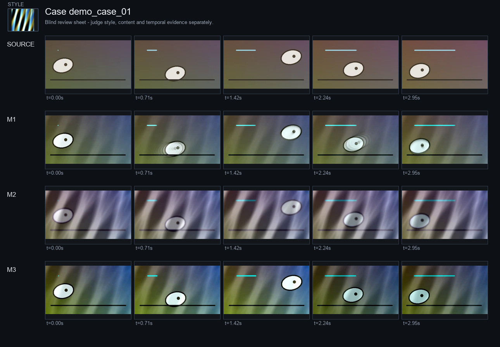
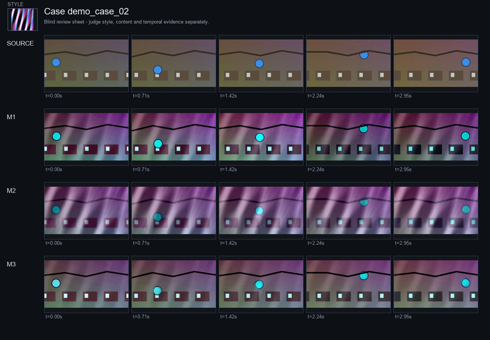
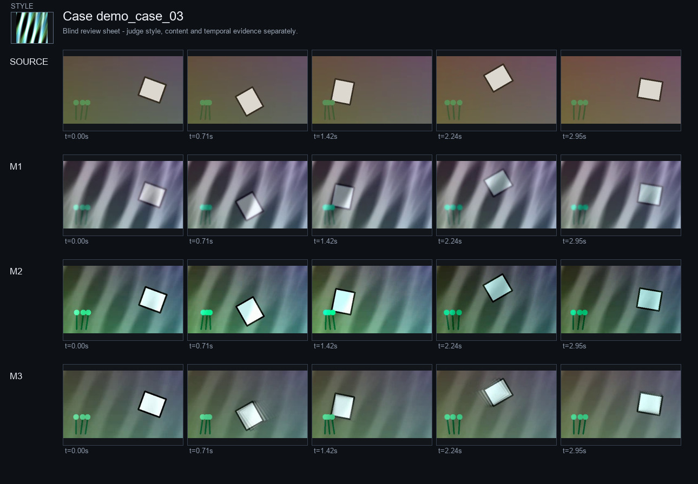

# 视频风格迁移评估报告

**报告 ID:** `VST-20261124T161521-8c45376dabc9`  
**时间:** 2026-11-24 16:15:21  
**证据:** `examples/sample_report/demo_evaluation/metrics.json`  
**基准:** [video-style-transfer-eval](https://github.com/0x0addc001/video-style-transfer-eval)

## 关键结果

| 维度 | 代表指标 | 方法1 | 方法2 | 方法3 |
|---|---|---|---|---|
| 风格 | CSD-S 风格一致性 | **0.9300 ± 0.0086** | 0.8118 ± 0.0073 | <u>0.8813 ± 0.0109</u> |
| 内容 | SSIM 结构相似度 | **0.9290 ± 0.0165** | <u>0.8111 ± 0.0326</u> | 0.7153 ± 0.0149 |
| 时序 | 重映射 RMSE Δ1 | **31.70 ± 6.7038** | <u>47.77 ± 10.70</u> | 63.87 ± 6.8744 |
| 视频质量 | VBench 美学质量 | **0.5302 ± 0.0135** | <u>0.4643 ± 0.0164</u> | 0.3957 ± 0.0270 |
| 成本 | 运行时间 | 18.80 ± 0.4000 | **15.00 ± 0.4000** | <u>16.50 ± 0.4000</u> |

## 评估配置

| 配置项 | 取值 |
|---|---|
| 与试方法 | 方法1, 方法2, 方法3 |
| 随机种子 | 2026 |
| 每个视频采样帧数 | 30 |
| 最大评估边长 | 320 px |
| 时序偏移 | [1, 5] |
| 光流实现 | OpenCV Farneback |
| 评审模型 | Codex multimodal visual inspection |

### 指标配置

**定量指标**

| 指标族 | 指标 |
|---|---|
| 风格 | CSD-S 风格一致性, LAB 调色板 W1, LAB 色度 W1 |
| 内容 | SSIM 结构相似度, PSNR 峰值信噪比, CSD-C 内容一致性 |
| 时序 | 重映射 RMSE Δ1, 重映射 RMSE Δ5, 亮度闪烁, VBench 主体一致性, VBench 背景一致性, VBench 时序闪烁 |
| 运动 | 光流端点误差 Δ1, 光流相关性 Δ1, VBench 运动平滑度, VBench 动态程度 |
| 视频质量 | VBench 美学质量, VBench 成像质量 |
| 成本 | 运行时间, 峰值 GPU 显存 |

**定性指标**

| 维度 | 取值 |
|---|---|
| 风格一致性 | 1-5 |
| 内容保持 | 1-5 |
| 时序稳定性 | 1-5 |
| 伪影控制 | 1-5 |
| 整体视觉质量 | 1-5 |

### 数据配置

| 配置项 | 取值 |
|---|---|
| 数量 | 3 |
| 来源 | https://huggingface.co/datasets/HiDream-ai/ReCo-Bench |
| 内容数 | 3 |
| 风格数 | 3 |
| 平均时长 | 3.00 s |
| 分辨率 | 384x216 |

## 定量结果

### 风格迁移

| 指标 | 方法1 | 方法2 | 方法3 |
|---|---|---|---|
| CSD-S 风格一致性 (cosine) ↑ | **0.9300 ± 0.0086** | 0.8118 ± 0.0073 | <u>0.8813 ± 0.0109</u> |
| LAB 调色板 W1 (normalized x100) ↓ | 9.0208 ± 0.5445 | **7.4201 ± 0.5347** | <u>8.0416 ± 0.9411</u> |
| LAB 色度 W1 (normalized x100) ↓ | <u>3.1765 ± 1.3380</u> | **1.8824 ± 1.0178** | 4.6879 ± 0.4238 |

最优和次优均值分别以粗体和下划线标出。 有效片段数：balanced: 3; flicker: 3; overlay: 3。

*结论:* CSD-S 风格一致性 ↑：方法1 0.9300 对 方法2 0.8118（更优；n=3）。

### 内容保持

| 指标 | 方法1 | 方法2 | 方法3 |
|---|---|---|---|
| SSIM 结构相似度 ↑ | **0.9290 ± 0.0165** | <u>0.8111 ± 0.0326</u> | 0.7153 ± 0.0149 |
| PSNR 峰值信噪比 (dB) ↑ | **22.58 ± 0.9018** | <u>17.54 ± 0.3337</u> | 14.90 ± 0.3931 |
| CSD-C 内容一致性 (cosine) ↑ | **0.9036 ± 0.0177** | <u>0.8440 ± 0.0098</u> | 0.8007 ± 0.0147 |

最优和次优均值分别以粗体和下划线标出。 有效片段数：balanced: 3; flicker: 3; overlay: 3。

*结论:* SSIM 结构相似度 ↑：方法1 0.9290 对 方法2 0.8111（更优；n=3）。

### 时序与运动

| 指标 | 方法1 | 方法2 | 方法3 |
|---|---|---|---|
| 重映射 RMSE Δ1 (RGB levels) ↓ | **31.70 ± 6.7038** | <u>47.77 ± 10.70</u> | 63.87 ± 6.8744 |
| 重映射 RMSE Δ5 (RGB levels) ↓ | **33.20 ± 5.2688** | <u>46.18 ± 10.55</u> | 63.70 ± 7.5960 |
| 光流端点误差 Δ1 (px) ↓ | <u>0.2438 ± 0.0558</u> | 0.5426 ± 0.3239 | **0.1874 ± 0.0547** |
| 光流相关性 Δ1 ↑ | **0.4268 ± 0.2381** | 0.2267 ± 0.0923 | <u>0.2662 ± 0.1339</u> |
| 亮度闪烁 (gray levels) ↓ | <u>0.1035 ± 0.0619</u> | 12.43 ± 0.4689 | **0.0822 ± 0.0217** |
| VBench 主体一致性 (0-1) ↑ | **0.9425 ± 0.0136** | 0.8377 ± 0.0176 | <u>0.8927 ± 0.0116</u> |
| VBench 背景一致性 (0-1) ↑ | **0.9355 ± 0.0019** | 0.8661 ± 0.0181 | <u>0.8791 ± 0.0076</u> |
| VBench 时序闪烁 (0-1) ↑ | **0.9607 ± 0.0175** | 0.7808 ± 0.0130 | <u>0.9182 ± 0.0121</u> |
| VBench 运动平滑度 (0-1) ↑ | **0.9854 ± 0.0074** | 0.9101 ± 0.0119 | <u>0.9438 ± 0.0060</u> |
| VBench 动态程度 (0-1) ↑ | <u>0.6688 ± 0.0417</u> | 0.6407 ± 0.0451 | **0.6759 ± 0.0569** |

最优和次优均值分别以粗体和下划线标出。 有效片段数：balanced: 3; flicker: 3; overlay: 3。

*结论:* 重映射 RMSE Δ1 ↓：方法1 31.70 对 方法2 47.77（更优；n=3）。

### 视频质量

| 指标 | 方法1 | 方法2 | 方法3 |
|---|---|---|---|
| VBench 美学质量 (0-1) ↑ | **0.5302 ± 0.0135** | <u>0.4643 ± 0.0164</u> | 0.3957 ± 0.0270 |
| VBench 成像质量 (MUSIQ 0-100) ↑ | **61.11 ± 0.3670** | <u>53.92 ± 2.0326</u> | 48.08 ± 2.1455 |

最优和次优均值分别以粗体和下划线标出。 有效片段数：balanced: 3; flicker: 3; overlay: 3。

*结论:* VBench 美学质量 ↑：方法1 0.5302 对 方法2 0.4643（更优；n=3）。

### 计算成本

| 指标 | 方法1 | 方法2 | 方法3 |
|---|---|---|---|
| 运行时间 (s) ↓ | 18.80 ± 0.4000 | **15.00 ± 0.4000** | <u>16.50 ± 0.4000</u> |
| 峰值 GPU 显存 (GB) ↓ | 12.70 ± 0.0000 | **9.8000 ± 0.0000** | <u>10.40 ± 0.0000</u> |

最优和次优均值分别以粗体和下划线标出。 有效片段数：balanced: 3; flicker: 3; overlay: 3。

*结论:* 运行时间 ↓：方法1 18.80 对 方法2 15.00（较差；n=3）。

### 相对主基线的配对比较

| 方法 | Δ (positive favors primary) | dz | 95% CI | n |
|---|---|---|---|---|
| SSIM 结构相似度 | 0.1180 | 7.1536 | — | 3 |
| LAB 调色板 W1 | -1.6007 | -15.05 | — | 3 |
| CSD-S 风格一致性 | 0.1182 | 14.21 | — | 3 |
| CSD-C 内容一致性 | 0.0596 | 2.4649 | — | 3 |
| 重映射 RMSE Δ1 | 16.08 | 3.9236 | — | 3 |
| 光流端点误差 Δ1 | 0.2988 | 1.0159 | — | 3 |
| VBench 运动平滑度 | 0.0753 | 6.1394 | — | 3 |
| VBench 美学质量 | 0.0659 | 2.2670 | — | 3 |
| VBench 成像质量 | 7.1882 | 3.5071 | — | 3 |
| 运行时间 | -3.8000 | n/a | — | 3 |

表中为有效配对片段上的平均值 ± 样本标准差，统计单位为片段。粗体和下划线分别表示最优和次优均值，箭头表示指标偏好方向。

## 定性评估（VLM）

| 方法 | 风格 | 内容 | 时序 | 伪影 | 整体 |
|---|---|---|---|---|---|
| 方法1 | 4.00/5 | 4.67/5 | 3.67/5 | 3.33/5 | 4.00/5 |
| 方法2 | 4.67/5 | 3.67/5 | 2.00/5 | 2.00/5 | 2.33/5 |
| 方法3 | 3.33/5 | 3.00/5 | 3.00/5 | 2.00/5 | 2.00/5 |

失败标签: 细节损失 (3), 纹理附着/粘连 (3), 闪烁 (3), 边缘重影 (2), 时序跳变 (2), 纹理漂移 (1), 几何融化 (1).

审查记录数: 1. 已评分案例/方法记录: 9. VLM 评分是感知证据，不是真实标签。

## 分析与讨论

### 风格保真度

现有指标总体上更支持 方法2。 已报告的诊断值为：CSD-S 风格一致性 0.9300 ± 0.0086；LAB 调色板 W1 9.0208 ± 0.5445；LAB 色度 W1 3.1765 ± 1.3380。 盲评风格一致性为 4.00/5。

### 内容保持

现有指标总体上更支持 方法1。 已报告的诊断值为：CSD-C 内容一致性 0.9036 ± 0.0177；SSIM 结构相似度 0.9290 ± 0.0165；PSNR 峰值信噪比 22.58 ± 0.9018。

### 运动与时序稳定性

现有指标总体上更支持 方法1。 已报告的诊断值为：重映射 RMSE Δ1 31.70 ± 6.7038；重映射 RMSE Δ5 33.20 ± 5.2688；光流端点误差 Δ1 0.2438 ± 0.0558；亮度闪烁 0.1035 ± 0.0619；VBench 主体一致性 0.9425 ± 0.0136；VBench 背景一致性 0.9355 ± 0.0019；VBench 时序闪烁 0.9607 ± 0.0175；VBench 运动平滑度 0.9854 ± 0.0074。

### 视频质量（VBench）

现有指标总体上更支持 方法1。 已报告的视频质量指标为：VBench 美学质量 0.5302 ± 0.0135；VBench 成像质量 61.11 ± 0.3670。

### 感知审查与失败模式

盲评中整体视觉质量最高的是 方法1（4.00/5，1 位审查者）。该结果仅代表当前审查样本中的感知偏好，不等同于真实标签。 主要失败模式为细节损失（3）、纹理附着/粘连（3）、闪烁（3）。

### 计算成本

现有指标总体上更支持 方法2。 主方法的运行时间 18.80 ± 0.4000 秒、峰值显存 12.70 ± 0.0000 GB。

### 综合判断

结果呈现明显的多维权衡，没有方法在所有维度上占优；因此不能据此声称单一方法的普遍优越性。

## 结论

本报告用 3 个案例验证了评估流程，未提供基准性能证据。结果表、感知分析和结论仍保留多维证据，不应被解释为 EchoStyle 或本文方法的基准排名。

## 备注

- 示例为合成片段与 CSD/VBench 占位数值，仅用于演示评估流程，不代表模型性能。

## 附录

### A. 指标定义与设计动机

#### SSIM 结构相似度

**可用性:** 在本次运行中计算

$$SSIM(x,y) = ((2*mu_x*mu_y + C1)*(2*sigma_xy + C2)) / ((mu_x^2 + mu_y^2 + C1)*(sigma_x^2 + sigma_y^2 + C2))$$

**设计动机:** SSIM 比较局部亮度、对比度和结构，而不是原始像素误差。它适合检测几何和结构变化，但强风格化本身也会改变对比度与纹理。

**解释与报告注意事项:** 应将其视为内容诊断，而不是感知风格分数。

#### PSNR 峰值信噪比

**可用性:** 在本次运行中计算

$$PSNR = 10 * log10(MAX^2 / MSE)$$

**设计动机:** PSNR 将均方误差转换为对数尺度，提供快速、确定性的保真度诊断。它对全局颜色变化、压缩和分辨率差异较敏感。

**解释与报告注意事项:** 不能把 PSNR 的小幅变化直接解释为感知质量的等比例变化。

#### LPIPS 感知距离

**可用性:** 本次运行未提供；定义用于论文级扩展

$$LPIPS(x,y) = sum_l (1/(H_l*W_l)) * sum_hw ||w_l * (phi_l(x)_hw - phi_l(y)_hw)||^2$$

**设计动机:** LPIPS 比较归一化深层特征，通常比像素指标更符合人类感知相似性。在有固定 LPIPS 实现时，应优先作为内容保持证据。

**解释与报告注意事项:** 所有比较方法必须使用相同的网络、预处理和权重。

#### CLIP-F 内容语义相似度

**可用性:** 本次运行未提供；定义用于论文级扩展

$$CLIP-F(R,I) = 100 * cos(phi_I(R), phi_I(I))$$

**设计动机:** CLIP-F 衡量风格化帧与源帧是否保留相同的图像级语义。当外观变化较大时，它可以补充结构指标。

**解释与报告注意事项:** 图像级嵌入可能遗漏局部身份、边界和遮挡错误。

#### CLIP-I 风格图像相似度

**可用性:** 本次运行未提供；定义用于论文级扩展

$$CLIP-I(R,S) = 100 * cos(phi_I(R), phi_I(S))$$

**设计动机:** CLIP-I 提供对内容变化较稳健的全局信号，用于判断生成帧与风格参考是否位于相近的语义视觉空间。它只是风格证据的一部分，不能单独证明纹理迁移成功。

**解释与报告注意事项:** 应进行相对比较，并结合纹理特征或盲评审查。

#### FID 分布距离

**可用性:** 本次运行未提供；定义用于论文级扩展

$$FID = ||mu_s - mu_g||_2^2 + Tr(S_s + S_g - 2*(S_s*S_g)^(1/2))$$

**设计动机:** FID 比较 Inception 特征分布，因此能捕捉超出单图颜色统计的风格集合差异。它需要足够数量的参考和生成帧来估计分布。

**解释与报告注意事项:** 单张风格图不能构成有效的 FID 风格分布。必须记录图像数量、分辨率和预处理。

#### ArtFID 联合风格-内容距离

**可用性:** 本次运行未提供；定义用于论文级扩展

$$ArtFID = (1 + mean_i LPIPS(I_i,R_i)) * (1 + FID(R,S))$$

**设计动机:** ArtFID 将感知内容保持和风格分布距离结合为一个数值。乘积形式会让“一个因素改善、另一个因素退化”的方法暴露出来。

**解释与报告注意事项:** 除非 LPIPS 和 FID 分量遵循固定的引用实现，否则不要使用该指标。

#### LAB 调色板 W1

**可用性:** 在本次运行中计算

$$W1_c = sum_k |CDF_frame,c(k) - CDF_style,c(k)| / 255;  PaletteW1 = 100 * mean_c W1_c$$

**设计动机:** 该低成本的诊断指标概括 LAB 颜色边缘分布的一致性，可在运行昂贵感知指标前发现全局着色和调色板不匹配。

**解释与报告注意事项:** 它不衡量笔触、纹理附着、构图或风格语义。

#### 源光流重映射 RMSE

**可用性:** 在本次运行中计算

$$WarpRMSE_d = sqrt(sum_x M_t(x)*||R_t(x) - W(R_(t+d))(x)||_2^2 / sum_x M_t(x))$$

**设计动机:** 源视频光流提供预期运动。使用该光流将后续输出帧重映射回当前帧，可以将漂移和闪烁与正常场景运动分开，并屏蔽遮挡像素。

**解释与报告注意事项:** 结果会继承光流估计器的误差；Farneback 是诊断代理，不是 RAFT。

#### 光流端点误差

**可用性:** 在本次运行中计算

$$EPE_d = (1/|Omega|) * sum_{x in Omega} ||F_R(x) - F_I(x)||_2$$

**设计动机:** EPE 衡量风格化是否改变帧间估计位移，可揭示静态图像难以发现的运动改变和传播失败。

**解释与报告注意事项:** 纹理变化可能产生虚假光流；所有方法必须使用相同估计器和遮挡处理。

#### 光流场相关性

**可用性:** 在本次运行中计算

$$rho_d = corr(flatten(F_R), flatten(F_I))$$

**设计动机:** 相关性衡量运动方向的一致性，相比 EPE 更少受幅度影响。两者结合可以区分方向错误和位移尺度变化。

**解释与报告注意事项:** 这是一个全局概括，可能掩盖局部运动错误。

#### 时序 LPIPS（tLP）

**可用性:** 本次运行未提供；定义用于论文级扩展

$$tLP = (1/(T-d)) * sum_t LPIPS(R_t, W(R_(t+d)))$$

**设计动机:** tLP 在重映射分析中用深层特征感知误差替代像素误差，使纹理和结构不稳定性比原始 L2 差值更容易被检测。

**解释与报告注意事项:** 必须使用固定的 LPIPS 网络并报告时间偏移。

#### CLIP 时序一致性

**可用性:** 本次运行未提供；定义用于论文级扩展

$$CLIP-CONS = 100 * cos(phi(R_t+1)-phi(R_t), phi(I_t+1)-phi(I_t))$$

**设计动机:** CLIP-CONS 检查相邻风格化帧的语义变化是否与源视频一致。当内容被强风格化时，它可以补充像素重映射指标。

**解释与报告注意事项:** 它衡量语义变化一致性，而不是空间对齐或闪烁。

#### 去趋势亮度闪烁

**可用性:** 在本次运行中计算

$$F = sqrt((1/T) * sum_t (l_t - (a*t+b))^2), where l_t is frame mean luminance$$

**设计动机:** 去除线性亮度趋势可以区分合理的曝光变化和突发全局闪烁。该指标成本低，直接针对常见的视频风格迁移伪影。

**解释与报告注意事项:** 它忽略局部闪烁和纹理粘连，这些需要运动感知指标或视觉审查。

#### 盲评 VLM 分数

**可用性:** 在本次运行中计算

$$S_d,m = (1/R) * sum_r (1/|C_valid|) * sum_c s_(r,c,m,d), s in {1,2,3,4,5}$$

**设计动机:** 该评分标准覆盖风格一致性、内容保持、时序稳定性、伪影控制和整体质量，能补充自动指标难以区分的纹理与运动故障。逐案例盲化方法标签可降低方法身份偏差。

**解释与报告注意事项:** VLM 判断是感知证据而非真实标签；应记录模型版本，并使用多个独立审查者支持论文级结论。

#### 运行时间与峰值显存

**可用性:** 在本次运行中计算

$$Runtime_m = mean_c t_(c,m); PeakMemory_m = max_c peak_(c,m)$$

**设计动机:** 如果缺少部署成本，质量比较并不完整。平均运行时间反映预期延迟，最大峰值显存反映最差观测资源需求。

**解释与报告注意事项:** 必须在相同硬件、精度、分辨率和批设置下测量，并同时报告均值和峰值。

#### CSD-S 风格一致性

**可用性:** 在本次运行中计算

$$CSD-S = (1/(T-1)) * sum_{t=1}^{T-1} cos(s(f_t), s(f_0))$$

**设计动机:** CSD（对比式风格描述子）以 CLIP ViT-L/14 图像编码器为骨干，训练出彼此分离的风格头 s(·) 与内容头 c(·)。将后续每一帧与首帧比较，可以在不混入内容变化的情况下度量风格漂移，对应 EchoStyle（ECCV 2026）报告中的“Style Consis.”列。

**解释与报告注意事项:** 该分数是图像级汇总，无法定位漂移位置。所有方法必须固定 CSD checkpoint、CLIP 预处理和抽帧方式；不同 CSD 变体的绝对余弦值不可直接比较。

#### CSD-C 内容一致性

**可用性:** 在本次运行中计算

$$CSD-C = (1/(T-1)) * sum_{t=1}^{T-1} cos(c(f_t), c(f_0))$$

**设计动机:** 同一套解耦 CSD 模型的内容头提供配套的漂移信号。将 CSD-S 与 CSD-C 分开报告，可以区分“风格保持但内容逐渐融化”与“风格和内容一起丢失”两种失效模式。

**解释与报告注意事项:** 内容头是语义嵌入，不是几何或时序模型。在得出“内容得到保持”的结论前，应结合源光流重映射误差与 CLIP-F。

#### VBench 主体一致性

**可用性:** 在本次运行中计算

$$SubjectCons = (1/(T-1)) * sum_t cos(d(f_t), d(f_(t+1))), d = DINO ViT-S/16$$

**设计动机:** VBench 使用 DINO 特征判断同一主体是否在帧间保持一致。在视频风格化中，该指标可以捕捉调色板与像素指标遗漏的主体身份变形和主体级闪烁。

**解释与报告注意事项:** 该指标偏袒静态片段：主体不变时天然得分高。应与动态程度和运动平滑度一起解读，并注意 custom_input 模式下的 VBench 结果不能与官方榜单直接比较。

#### VBench 背景一致性

**可用性:** 在本次运行中计算

$$BgCons = (1/(T-1)) * sum_t cos(c(f_t), c(f_(t+1))), c = CLIP ViT-B/32$$

**设计动机:** 背景一致性衡量场景上下文在帧间是否漂移或跳变，与主体一致性互补：方法可能保持人物不变，却在重新绘制其背后的房间。

**解释与报告注意事项:** CLIP 特征较粗糙，仍可能混合主体与背景；主体/背景的区分只能视为指示性而非精确划分。

#### VBench 时序闪烁

**可用性:** 在本次运行中计算

$$Flicker = 1 - (1/(T-1)) * sum_t mean|I_(t+1) - I_t|, I in [0,1]$$

**设计动机:** VBench 的像素级静态一致性项惩罚相邻帧之间的突发全局变化。它可作为诊断性亮度闪烁指标的交叉验证，因为它对全部通道敏感，而不只是亮度。

**解释与报告注意事项:** 像素差异同样会惩罚合理的快速运动和硬切。不能仅凭该指标把动态片段与静态片段放在一起排名。

#### VBench 运动平滑度

**可用性:** 在本次运行中计算

$$MotionSmooth = 1 - (1/(T-2)) * sum_t ||I_t - AMT(I_(t-1), I_(t+1))||^2$$

**设计动机:** VBench 用 AMT 对留出帧做插值，并把插值误差作为平滑度信号。与源到输出的光流指标不同，它不需要配对源视频，因此在只有生成视频时也能使用。

**解释与报告注意事项:** 该分数依赖 AMT checkpoint，并会部分奖励运动模糊或过度平滑；模糊的结果可能显得“平滑”。

#### VBench 动态程度

**可用性:** 在本次运行中计算

$$DynDegree = (1/|V|) * sum_v 1[mean flow magnitude(v) > tau]$$

**设计动机:** 动态程度报告被判定为具有足够运动量的片段比例，是 VBench 用来防止模型通过生成近乎静止的视频来“通过”一致性指标的护栏。

**解释与报告注意事项:** 并非越高越好：夸张运动会提高该分数，却损害内容保真度。只能在源运动量可比的片段之间比较。

#### VBench 美学质量

**可用性:** 在本次运行中计算

$$Aesthetic = (1/T) * sum_t LAION-Aesthetic(I_t)$$

**设计动机:** LAION 美学预测器为每帧提供学习到的偏好分数，是少数能回答“看起来是否好看”这一像素保真指标无法回答的问题的公开信号。

**解释与报告注意事项:** 该预测器基于摄影美学训练，可能惩罚刻意为之的绘画、水墨或强风格化纹理。绝不能单独把它当作风格迁移分数。

#### VBench 成像质量

**可用性:** 在本次运行中计算

$$Imaging = (1/T) * sum_t MUSIQ(I_t)$$

**设计动机:** MUSIQ 是无参考图像质量模型，无需真值即可标记压缩、模糊与噪声伪影。EchoStyle 将其作为“Imaging Qual.”列报告。

**解释与报告注意事项:** 无参考质量模型可能奖励过度锐化，并给纹理强烈的绘画风格打更低的分。必须报告模型版本与输入分辨率。

### B. 数据集与配对

| 案例 | 内容 | 风格 | 数据划分 | 有效方法 | 警告 |
|---|---|---|---|---|---|
| demo_case_01 | content_01 | style_01 | synthetic_demo | 方法1, 方法2, 方法3 | 无 |
| demo_case_02 | content_02 | style_02 | synthetic_demo | 方法1, 方法2, 方法3 | 无 |
| demo_case_03 | content_03 | style_03 | synthetic_demo | 方法1, 方法2, 方法3 | 无 |

### C. 单案例结果

#### demo_case_01

| 方法 | SSIM 越高越好 | 调色板 W1 越低越好 | 重映射 RMSE Δ1 越低越好 | 光流 EPE Δ1 越低越好 |
|---|---|---|---|---|
| 方法1 | 0.9395 | 8.8136 | 28.61 | 0.2963 |
| 方法2 | 0.8270 | 7.3344 | 44.06 | 0.5494 |
| 方法3 | 0.7122 | 8.1708 | 65.43 | 0.1389 |

#### demo_case_02

| 方法 | SSIM 越高越好 | 调色板 W1 越低越好 | 重映射 RMSE Δ1 越低越好 | 光流 EPE Δ1 越低越好 |
|---|---|---|---|---|
| 方法1 | 0.9101 | 8.6103 | 39.39 | 0.2500 |
| 方法2 | 0.7736 | 6.9334 | 59.84 | 0.8630 |
| 方法3 | 0.7315 | 7.0425 | 69.83 | 0.2467 |

#### demo_case_03

| 方法 | SSIM 越高越好 | 调色板 W1 越低越好 | 重映射 RMSE Δ1 越低越好 | 光流 EPE Δ1 越低越好 |
|---|---|---|---|---|
| 方法1 | 0.9376 | 9.6385 | 27.09 | 0.1852 |
| 方法2 | 0.8327 | 7.9925 | 39.42 | 0.2154 |
| 方法3 | 0.7022 | 8.9114 | 56.35 | 0.1766 |

### D. 消融与权衡

本报告只比较已观察到的配置。除非在固定内容、运动和随机种子的条件下完成受控的风格强度扫描，否则不能声称已建立风格-保持前沿。

### E. 失败案例

上方联系表构成视觉证据包。失败判断应结合审查证据和时间点；仅有吸引力较高的静态帧不足以证明时序质量。

### F. 有效性威胁

- 内容与风格的数据分布可能不能代表实际使用场景。
- 低层指标容易受全局着色和压缩影响。
- Farneback 光流不是 RAFT，在大运动或遮挡条件下可能失效。
- 单张风格图不能构成有效的 FID 风格分布。
- VLM 审查可能受到位置、内容和提示词偏差影响。
- 直接引用论文的外部基线数值可能没有统一推理设置。
- 少于五个片段时，比较置信区间不稳定。

